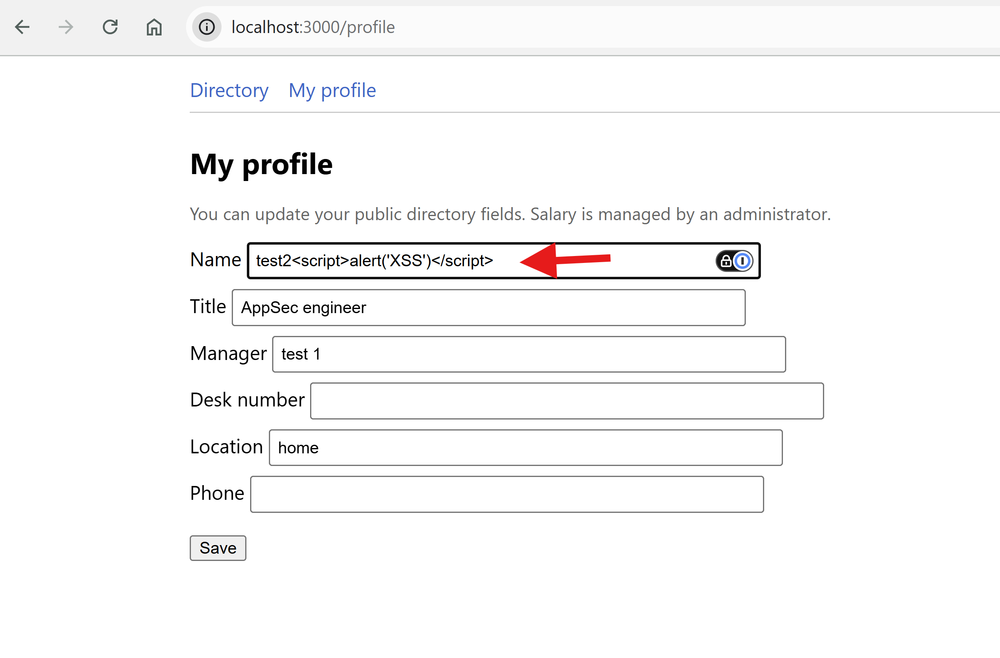
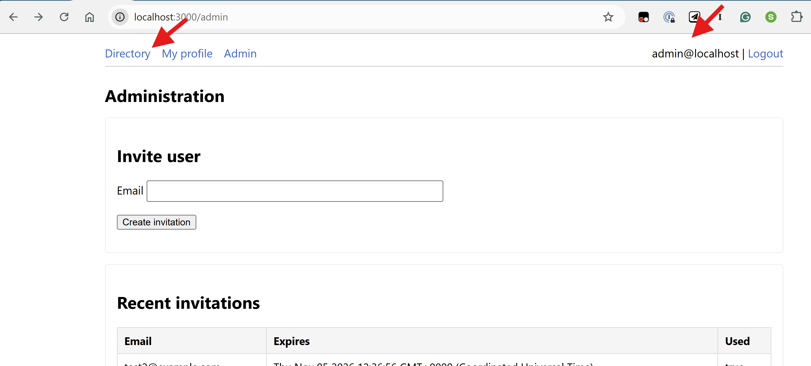
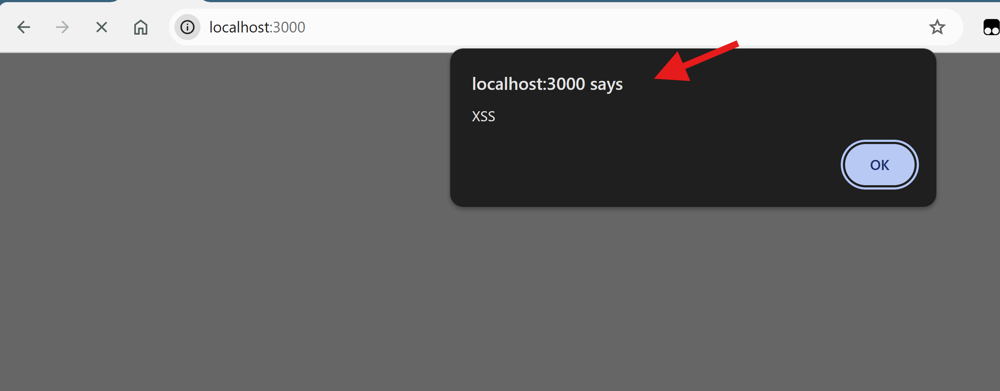

# Secure Code Review — Challenge #8: Employee Directory — Solution

<table>
<tr>
<td width="100%">

<a href="https://youtu.be/puGX2iZNln0">
  
</a>

### 🎥 This solution is explained in detail on my YouTube Channel  [AppSec Untangled](https://www.youtube.com/@AppSecUntangled)

Full walkthrough of the review process, the finding, and the fix.

[](https://youtu.be/puGX2iZNln0)

</td>
</tr>
</table>

---

# Part I: Review Steps

*The methodology followed to build a mental model of the system before looking for the flaw. It
mirrors the [suggested methodology](../../README.md#suggested-methodology): scope → entry points →
sinks → threat model → mitigation review.*

## 1. 🗺️ Application scope & architecture

Employee Directory is an internal phonebook. Every account is an **employee** or an **admin**.
Employees can read everyone's *public* fields and edit their own, and admins can manage everything.
The asset the whole design protects is the **salary** field, plus the **admin role** that unlocks it.

### 🚀 What happens when the app starts

1. **`docker compose up` starts two containers.** One is a stock `mongo:7`, a black box we don't
   review. The other is our `app`, built from the local `Dockerfile`, which gets its secrets from `.env`
   ([docker-compose.yml:1-30](https://github.com/mohamed-osama-aboelkheir/the-secure-code-review-challenge/blob/main/challenges/008-employee-directory/docker-compose.yml#L1-L30)).

2. **The `Dockerfile` installs production dependencies and runs `node app.js` as an unprivileged
   user** ([Dockerfile:1-17](https://github.com/mohamed-osama-aboelkheir/the-secure-code-review-challenge/blob/main/challenges/008-employee-directory/Dockerfile#L1-L17)):

   ```dockerfile
   RUN useradd -m -u 1001 appuser && chown -R appuser:appuser /app
   USER appuser
   CMD ["node", "app.js"]
   ```

3. **`app.js` boots [Express](https://expressjs.com/en/4x/api.html) and refuses to start without a
   `JWT_SECRET`**
   ([app.js:17-23](https://github.com/mohamed-osama-aboelkheir/the-secure-code-review-challenge/blob/main/challenges/008-employee-directory/app.js#L17-L23)).
   It then configures **[Nunjucks](https://mozilla.github.io/nunjucks/), the template engine
   that renders every HTML page**
   ([app.js:55-61](https://github.com/mohamed-osama-aboelkheir/the-secure-code-review-challenge/blob/main/challenges/008-employee-directory/app.js#L55-L61)):

   ```js
   nunjucks.configure(viewsPath, {
     autoescape: false,
     express: app,
     noCache: process.env.NODE_ENV !== 'production'
   });
   ```

   Keep that `autoescape` option in mind. It decides whether `{{ value }}` in a template is
   HTML-encoded before it reaches the page
   ([Nunjucks `configure` docs](https://mozilla.github.io/nunjucks/api.html#configure)).

4. **The global middleware runs in this order**
   ([app.js:63-79](https://github.com/mohamed-osama-aboelkheir/the-secure-code-review-challenge/blob/main/challenges/008-employee-directory/app.js#L63-L79)):
   - `express.json()` / `express.urlencoded()` parse the request body.
   - [`cookie-parser`](https://github.com/expressjs/cookie-parser) parses cookies, which the web UI
     needs because its JWT lives in a `token` cookie.
   - [`express-mongo-sanitize`](https://github.com/fiznool/express-mongo-sanitize) is a **security
     control**. It strips keys that start with `$` or contain `.` from `req.body`, `req.query` and
     `req.params`.
   - `optionalAuth` decodes the JWT (from a header or cookie) when one is present and sets `req.user`.
   - `csrfMiddleware` is a **security control** that wraps
     [`csurf`](https://github.com/expressjs/csurf) in cookie mode
     ([app.js:26-46](https://github.com/mohamed-osama-aboelkheir/the-secure-code-review-challenge/blob/main/challenges/008-employee-directory/app.js#L26-L46)).
     Requests that carry `Authorization: Bearer` skip it, and so do the login, register and logout
     POSTs. Everything else that is cookie-authenticated and mutating needs a valid `_csrf` token.

5. **Four routers are mounted**
   ([app.js:85-88](https://github.com/mohamed-osama-aboelkheir/the-secure-code-review-challenge/blob/main/challenges/008-employee-directory/app.js#L85-L88)):
   `/` (server-rendered pages), `/api/auth`, `/api/employees` and `/api/admin`. There is also
   `GET /api/csrf-token`, which hands out a CSRF token for the current cookie session
   ([app.js:81-83](https://github.com/mohamed-osama-aboelkheir/the-secure-code-review-challenge/blob/main/challenges/008-employee-directory/app.js#L81-L83)).

6. **The data store is MongoDB through [Mongoose](https://mongoosejs.com/docs/)**, with three models
   ([directoryStore.js:5-33](https://github.com/mohamed-osama-aboelkheir/the-secure-code-review-challenge/blob/main/challenges/008-employee-directory/src/store/directoryStore.js#L5-L33)).
   `User` holds the email, a bcrypt hash and a `role` (enum `admin`/`employee`). `Employee` holds the
   public fields plus `salary`. `Invitation` holds a bcrypt-hashed one-time code with an expiry.

7. **Once Mongo answers, `ensureBootstrapAdmin` runs.** If no admin exists, it creates
   `admin@localhost` with a random password and prints it to the logs
   ([bootstrap.js:4-19](https://github.com/mohamed-osama-aboelkheir/the-secure-code-review-challenge/blob/main/challenges/008-employee-directory/src/bootstrap.js#L4-L19)).

### 🔄 What happens for the main use cases

1. **The admin invites a new hire.** `POST /api/admin/invitations` (or the `/admin/invite` form)
   calls `createInvitation`. It invalidates older codes for that email, generates 16 random bytes,
   stores only their bcrypt hash and returns the plaintext once
   ([directoryStore.js:224-240](https://github.com/mohamed-osama-aboelkheir/the-secure-code-review-challenge/blob/main/challenges/008-employee-directory/src/store/directoryStore.js#L224-L240)).

   ```mermaid
   sequenceDiagram
       autonumber
       box rgba(59,130,246,0.18) 🖥️ Browser
           actor A as Admin
       end
       box rgba(234,179,8,0.22) 🌐 Network (HTTP request)
           participant N as HTTP
       end
       box rgba(239,68,68,0.18) 🛡️ Backend middlewares
           participant OA as optionalAuth
           participant CS as csrfMiddleware
           participant RU as requireUser
       end
       box rgba(34,197,94,0.18) ⚙️ Backend handler
           participant H as POST /admin/invite
       end
       box rgba(168,85,247,0.18) 🗄️ Store
           participant S as DirectoryStore + MongoDB
       end
       A->>N: submit Invite user form
       N->>OA: POST /admin/invite<br/>Cookie: token · email, _csrf
       OA->>S: jwt.verify (HS256) → findUserById
       S-->>OA: user → req.user (role from DB)
       OA->>CS: next()
       CS->>CS: _csrf must match the CSRF cookie
       CS->>RU: next()
       RU->>H: req.user set → next()
       H->>H: role !== 'admin' → 403
       H->>S: createInvitation(email)
       S->>S: void old codes, randomBytes(16),<br/>store only the bcrypt hash
       S-->>H: { email, invitationCode, expiresAt }
       H-->>A: 200 admin.html shows the code once
   ```

   **Code locations by step:**

   1. [admin.html:14-18](https://github.com/mohamed-osama-aboelkheir/the-secure-code-review-challenge/blob/main/challenges/008-employee-directory/views/admin.html#L14-L18) — form with the hidden `_csrf` field
   2. [app.js:85](https://github.com/mohamed-osama-aboelkheir/the-secure-code-review-challenge/blob/main/challenges/008-employee-directory/app.js#L85) — pages router mounted at `/`
   3. [middleware/auth.js:70-82](https://github.com/mohamed-osama-aboelkheir/the-secure-code-review-challenge/blob/main/challenges/008-employee-directory/src/middleware/auth.js#L70-L82), [directoryStore.js:91-94](https://github.com/mohamed-osama-aboelkheir/the-secure-code-review-challenge/blob/main/challenges/008-employee-directory/src/store/directoryStore.js#L91-L94)
   4. [middleware/auth.js:83-90](https://github.com/mohamed-osama-aboelkheir/the-secure-code-review-challenge/blob/main/challenges/008-employee-directory/src/middleware/auth.js#L83-L90), [app.js:68-72](https://github.com/mohamed-osama-aboelkheir/the-secure-code-review-challenge/blob/main/challenges/008-employee-directory/app.js#L68-L72)
   5. [app.js:74](https://github.com/mohamed-osama-aboelkheir/the-secure-code-review-challenge/blob/main/challenges/008-employee-directory/app.js#L74)
   6. [app.js:26](https://github.com/mohamed-osama-aboelkheir/the-secure-code-review-challenge/blob/main/challenges/008-employee-directory/app.js#L26), [app.js:36-46](https://github.com/mohamed-osama-aboelkheir/the-secure-code-review-challenge/blob/main/challenges/008-employee-directory/app.js#L36-L46)
   7. [app.js:45](https://github.com/mohamed-osama-aboelkheir/the-secure-code-review-challenge/blob/main/challenges/008-employee-directory/app.js#L45)
   8. [pages.js:10-15](https://github.com/mohamed-osama-aboelkheir/the-secure-code-review-challenge/blob/main/challenges/008-employee-directory/src/routes/pages.js#L10-L15)
   9. [pages.js:138-141](https://github.com/mohamed-osama-aboelkheir/the-secure-code-review-challenge/blob/main/challenges/008-employee-directory/src/routes/pages.js#L138-L141)
   10. [pages.js:157](https://github.com/mohamed-osama-aboelkheir/the-secure-code-review-challenge/blob/main/challenges/008-employee-directory/src/routes/pages.js#L157) (API: [admin.js:11-19](https://github.com/mohamed-osama-aboelkheir/the-secure-code-review-challenge/blob/main/challenges/008-employee-directory/src/routes/admin.js#L11-L19), behind `requireAuth` + `requireAdmin`)
   11. [directoryStore.js:224-238](https://github.com/mohamed-osama-aboelkheir/the-secure-code-review-challenge/blob/main/challenges/008-employee-directory/src/store/directoryStore.js#L224-L238)
   12. [directoryStore.js:239](https://github.com/mohamed-osama-aboelkheir/the-secure-code-review-challenge/blob/main/challenges/008-employee-directory/src/store/directoryStore.js#L239) — the only time the plaintext code exists
   13. [pages.js:161-168](https://github.com/mohamed-osama-aboelkheir/the-secure-code-review-challenge/blob/main/challenges/008-employee-directory/src/routes/pages.js#L161-L168), [admin.html:11-13](https://github.com/mohamed-osama-aboelkheir/the-secure-code-review-challenge/blob/main/challenges/008-employee-directory/views/admin.html#L11-L13)

2. **The new hire registers.** `POST /api/auth/register` rejects duplicates, checks and consumes the
   invitation, then creates a user whose role is **hard-coded to `employee`**. It also creates their
   employee record and returns a JWT
   ([auth.js:66-97](https://github.com/mohamed-osama-aboelkheir/the-secure-code-review-challenge/blob/main/challenges/008-employee-directory/src/routes/auth.js#L66-L97)):

   ```js
   const user = await db.createUser(email, passwordHash, 'employee', null);
   ```

   ```mermaid
   sequenceDiagram
       autonumber
       box rgba(59,130,246,0.18) 🖥️ Browser
           actor U as New hire
       end
       box rgba(234,179,8,0.22) 🌐 Network (HTTP request)
           participant N as HTTP
       end
       box rgba(239,68,68,0.18) 🛡️ Backend middlewares
           participant MS as mongoSanitize
           participant CS as csrfMiddleware
       end
       box rgba(34,197,94,0.18) ⚙️ Backend handler
           participant H as POST /api/auth/register
       end
       box rgba(168,85,247,0.18) 🗄️ Store
           participant S as DirectoryStore + MongoDB
       end
       U->>N: submit register form
       N->>MS: POST /api/auth/register<br/>email, password, invitationCode, web=1
       MS->>MS: strip $ and . keys from the body
       MS->>CS: next()
       CS->>CS: path is in CSRF_EXEMPT_AUTH_POST → skip
       CS->>H: next()
       H->>S: findUserByEmail / findEmployeeByEmail
       H->>S: validateAndConsumeInvitation(email, code)
       S-->>H: true (unexpired hash matched, marked used)
       H->>S: createUser(email, hash, 'employee')
       H->>S: createEmployee + setUserEmployeeId
       H->>H: issueToken → HS256 JWT
       H-->>U: Set-Cookie token (httpOnly, SameSite=Lax)<br/>302 /
   ```

   **Code locations by step:**

   1. [register.html:8-14](https://github.com/mohamed-osama-aboelkheir/the-secure-code-review-challenge/blob/main/challenges/008-employee-directory/views/register.html#L8-L14) — sends `web=1`
   2. [app.js:86](https://github.com/mohamed-osama-aboelkheir/the-secure-code-review-challenge/blob/main/challenges/008-employee-directory/app.js#L86)
   3. [app.js:66](https://github.com/mohamed-osama-aboelkheir/the-secure-code-review-challenge/blob/main/challenges/008-employee-directory/app.js#L66)
   4. [app.js:74](https://github.com/mohamed-osama-aboelkheir/the-secure-code-review-challenge/blob/main/challenges/008-employee-directory/app.js#L74)
   5. [app.js:29-33](https://github.com/mohamed-osama-aboelkheir/the-secure-code-review-challenge/blob/main/challenges/008-employee-directory/app.js#L29-L33), [app.js:42-44](https://github.com/mohamed-osama-aboelkheir/the-secure-code-review-challenge/blob/main/challenges/008-employee-directory/app.js#L42-L44)
   6. [app.js:43](https://github.com/mohamed-osama-aboelkheir/the-secure-code-review-challenge/blob/main/challenges/008-employee-directory/app.js#L43)
   7. [auth.js:50-64](https://github.com/mohamed-osama-aboelkheir/the-secure-code-review-challenge/blob/main/challenges/008-employee-directory/src/routes/auth.js#L50-L64) (409 if taken), [directoryStore.js:86-89](https://github.com/mohamed-osama-aboelkheir/the-secure-code-review-challenge/blob/main/challenges/008-employee-directory/src/store/directoryStore.js#L86-L89), [directoryStore.js:144-147](https://github.com/mohamed-osama-aboelkheir/the-secure-code-review-challenge/blob/main/challenges/008-employee-directory/src/store/directoryStore.js#L144-L147)
   8. [auth.js:66-72](https://github.com/mohamed-osama-aboelkheir/the-secure-code-review-challenge/blob/main/challenges/008-employee-directory/src/routes/auth.js#L66-L72)
   9. [directoryStore.js:252-269](https://github.com/mohamed-osama-aboelkheir/the-secure-code-review-challenge/blob/main/challenges/008-employee-directory/src/store/directoryStore.js#L252-L269)
   10. [auth.js:74-76](https://github.com/mohamed-osama-aboelkheir/the-secure-code-review-challenge/blob/main/challenges/008-employee-directory/src/routes/auth.js#L74-L76) — role hard-coded, [directoryStore.js:76-84](https://github.com/mohamed-osama-aboelkheir/the-secure-code-review-challenge/blob/main/challenges/008-employee-directory/src/store/directoryStore.js#L76-L84)
   11. [auth.js:84-97](https://github.com/mohamed-osama-aboelkheir/the-secure-code-review-challenge/blob/main/challenges/008-employee-directory/src/routes/auth.js#L84-L97), [directoryStore.js:124-137](https://github.com/mohamed-osama-aboelkheir/the-secure-code-review-challenge/blob/main/challenges/008-employee-directory/src/store/directoryStore.js#L124-L137), [directoryStore.js:105-112](https://github.com/mohamed-osama-aboelkheir/the-secure-code-review-challenge/blob/main/challenges/008-employee-directory/src/store/directoryStore.js#L105-L112)
   12. [auth.js:99-100](https://github.com/mohamed-osama-aboelkheir/the-secure-code-review-challenge/blob/main/challenges/008-employee-directory/src/routes/auth.js#L99-L100), [auth.js:12-19](https://github.com/mohamed-osama-aboelkheir/the-secure-code-review-challenge/blob/main/challenges/008-employee-directory/src/routes/auth.js#L12-L19)
   13. [auth.js:102-105](https://github.com/mohamed-osama-aboelkheir/the-secure-code-review-challenge/blob/main/challenges/008-employee-directory/src/routes/auth.js#L102-L105), [auth.js:21-26](https://github.com/mohamed-osama-aboelkheir/the-secure-code-review-challenge/blob/main/challenges/008-employee-directory/src/routes/auth.js#L21-L26)

3. **Every user logs in.** `POST /api/auth/login` checks the password with
   [bcrypt](https://github.com/kelektiv/node.bcrypt.js) and signs an HS256 JWT. The web form also
   stores it in an `httpOnly`, `SameSite=Lax` cookie
   ([auth.js:12-26](https://github.com/mohamed-osama-aboelkheir/the-secure-code-review-challenge/blob/main/challenges/008-employee-directory/src/routes/auth.js#L12-L26),
   [auth.js:160-168](https://github.com/mohamed-osama-aboelkheir/the-secure-code-review-challenge/blob/main/challenges/008-employee-directory/src/routes/auth.js#L160-L168)).
   Admins are redirected straight to **`/admin`**.

   On every later request, `requireAuth` verifies the token with the algorithm pinned, then
   **re-loads the user from the database**. That means `req.user.role` always reflects the current
   DB role, not whatever was in the token
   ([middleware/auth.js:35-48](https://github.com/mohamed-osama-aboelkheir/the-secure-code-review-challenge/blob/main/challenges/008-employee-directory/src/middleware/auth.js#L35-L48)):

   ```js
   const decoded = jwt.verify(token, secret, { algorithms: ['HS256'] });
   const user = await db.findUserById(decoded.userId);
   ```

   ```mermaid
   sequenceDiagram
       autonumber
       box rgba(59,130,246,0.18) 🖥️ Browser
           actor U as User
       end
       box rgba(234,179,8,0.22) 🌐 Network (HTTP request)
           participant N as HTTP
       end
       box rgba(239,68,68,0.18) 🛡️ Backend middlewares
           participant MS as mongoSanitize
           participant CS as csrfMiddleware
           participant OA as optionalAuth / requireAuth
       end
       box rgba(34,197,94,0.18) ⚙️ Backend handler
           participant H as POST /api/auth/login
       end
       box rgba(168,85,247,0.18) 🗄️ Store
           participant S as DirectoryStore + MongoDB
       end
       U->>N: submit login form
       N->>MS: POST /api/auth/login<br/>email, password, web=1
       MS->>CS: operators stripped → next()
       CS->>H: exempt auth path → next()
       H->>S: findUserByEmail(email)
       S-->>H: user + passwordHash
       H->>H: bcrypt.compare → issueToken
       H-->>U: Set-Cookie token<br/>302 /admin (admin) or /
       Note over U,S: every later request
       U->>N: any later page or API call
       N->>OA: GET /admin, GET /api/employees …<br/>Cookie: token
       OA->>S: jwt.verify (algorithms: HS256) → findUserById
       S-->>OA: current user → req.user.role from DB
   ```

   **Code locations by step:**

   1. [login.html:8-13](https://github.com/mohamed-osama-aboelkheir/the-secure-code-review-challenge/blob/main/challenges/008-employee-directory/views/login.html#L8-L13)
   2. [app.js:86](https://github.com/mohamed-osama-aboelkheir/the-secure-code-review-challenge/blob/main/challenges/008-employee-directory/app.js#L86)
   3. [app.js:66](https://github.com/mohamed-osama-aboelkheir/the-secure-code-review-challenge/blob/main/challenges/008-employee-directory/app.js#L66)
   4. [app.js:29-33](https://github.com/mohamed-osama-aboelkheir/the-secure-code-review-challenge/blob/main/challenges/008-employee-directory/app.js#L29-L33), [app.js:42-44](https://github.com/mohamed-osama-aboelkheir/the-secure-code-review-challenge/blob/main/challenges/008-employee-directory/app.js#L42-L44)
   5. [auth.js:144-150](https://github.com/mohamed-osama-aboelkheir/the-secure-code-review-challenge/blob/main/challenges/008-employee-directory/src/routes/auth.js#L144-L150), [directoryStore.js:86-89](https://github.com/mohamed-osama-aboelkheir/the-secure-code-review-challenge/blob/main/challenges/008-employee-directory/src/store/directoryStore.js#L86-L89)
   6. [directoryStore.js:87-88](https://github.com/mohamed-osama-aboelkheir/the-secure-code-review-challenge/blob/main/challenges/008-employee-directory/src/store/directoryStore.js#L87-L88)
   7. [auth.js:152-160](https://github.com/mohamed-osama-aboelkheir/the-secure-code-review-challenge/blob/main/challenges/008-employee-directory/src/routes/auth.js#L152-L160), [auth.js:12-19](https://github.com/mohamed-osama-aboelkheir/the-secure-code-review-challenge/blob/main/challenges/008-employee-directory/src/routes/auth.js#L12-L19)
   8. [auth.js:162-168](https://github.com/mohamed-osama-aboelkheir/the-secure-code-review-challenge/blob/main/challenges/008-employee-directory/src/routes/auth.js#L162-L168)
   9. Browser re-sends the `token` cookie (or the client sends `Authorization: Bearer`)
   10. [app.js:68](https://github.com/mohamed-osama-aboelkheir/the-secure-code-review-challenge/blob/main/challenges/008-employee-directory/app.js#L68) (pages), [employees.js:11](https://github.com/mohamed-osama-aboelkheir/the-secure-code-review-challenge/blob/main/challenges/008-employee-directory/src/routes/employees.js#L11) (API, `requireAuth`)
   11. [middleware/auth.js:35-37](https://github.com/mohamed-osama-aboelkheir/the-secure-code-review-challenge/blob/main/challenges/008-employee-directory/src/middleware/auth.js#L35-L37) (`requireAuth`), [middleware/auth.js:80-82](https://github.com/mohamed-osama-aboelkheir/the-secure-code-review-challenge/blob/main/challenges/008-employee-directory/src/middleware/auth.js#L80-L82) (`optionalAuth`), [directoryStore.js:91-94](https://github.com/mohamed-osama-aboelkheir/the-secure-code-review-challenge/blob/main/challenges/008-employee-directory/src/store/directoryStore.js#L91-L94)
   12. [middleware/auth.js:42-48](https://github.com/mohamed-osama-aboelkheir/the-secure-code-review-challenge/blob/main/challenges/008-employee-directory/src/middleware/auth.js#L42-L48), [middleware/auth.js:83-90](https://github.com/mohamed-osama-aboelkheir/the-secure-code-review-challenge/blob/main/challenges/008-employee-directory/src/middleware/auth.js#L83-L90)

4. **An employee updates their own entry.** They can use the API, `PATCH /api/employees/me`, or the
   web form, `POST /profile`. Both look up *the caller's* employee record, block `salary` and copy
   only an allowlist of public fields
   ([employees.js:30-51](https://github.com/mohamed-osama-aboelkheir/the-secure-code-review-challenge/blob/main/challenges/008-employee-directory/src/routes/employees.js#L30-L51)):

   ```js
   if (Object.prototype.hasOwnProperty.call(req.body, 'salary')) {
     return res.status(403).json({ error: 'Cannot update salary through this endpoint' });
   }
   const allowed = ['name', 'title', 'manager', 'deskNumber', 'location', 'phone'];
   ```

   The values themselves go into Mongo **as typed**. There is no length, charset or format check on
   `name`, `phone` or `location`.

   ```mermaid
   sequenceDiagram
       autonumber
       box rgba(59,130,246,0.18) 🖥️ Browser
           actor E as Employee
       end
       box rgba(234,179,8,0.22) 🌐 Network (HTTP request)
           participant N as HTTP
       end
       box rgba(239,68,68,0.18) 🛡️ Backend middlewares
           participant MS as mongoSanitize
           participant OA as optionalAuth
           participant CS as csrfMiddleware
           participant RU as requireUser
       end
       box rgba(34,197,94,0.18) ⚙️ Backend handler
           participant H as POST /profile
       end
       box rgba(168,85,247,0.18) 🗄️ Store
           participant S as DirectoryStore + MongoDB
       end
       E->>N: submit My profile form
       N->>MS: POST /profile · Cookie: token<br/>name, title, …, phone, _csrf
       MS->>OA: strip $ keys → next()
       OA->>S: jwt.verify → findUserById
       S-->>OA: req.user
       OA->>CS: next()
       CS->>CS: _csrf must match the CSRF cookie
       CS->>RU: next()
       RU->>H: req.user set → next()
       H->>S: findEmployeeByUserId(req.user.id)
       H->>H: copy allowlisted fields only<br/>no salary, but no value validation
       H->>S: updateEmployeeById(emp.id, patch)
       S->>S: saves the value as typed<br/>(an onerror payload too)
       H-->>E: 302 /profile?saved=1
   ```

   **Code locations by step:**

   1. [profile.html:12-21](https://github.com/mohamed-osama-aboelkheir/the-secure-code-review-challenge/blob/main/challenges/008-employee-directory/views/profile.html#L12-L21)
   2. [app.js:85](https://github.com/mohamed-osama-aboelkheir/the-secure-code-review-challenge/blob/main/challenges/008-employee-directory/app.js#L85) (API: `PATCH /api/employees/me`, [app.js:87](https://github.com/mohamed-osama-aboelkheir/the-secure-code-review-challenge/blob/main/challenges/008-employee-directory/app.js#L87))
   3. [app.js:66](https://github.com/mohamed-osama-aboelkheir/the-secure-code-review-challenge/blob/main/challenges/008-employee-directory/app.js#L66)
   4. [middleware/auth.js:70-82](https://github.com/mohamed-osama-aboelkheir/the-secure-code-review-challenge/blob/main/challenges/008-employee-directory/src/middleware/auth.js#L70-L82), [directoryStore.js:91-94](https://github.com/mohamed-osama-aboelkheir/the-secure-code-review-challenge/blob/main/challenges/008-employee-directory/src/store/directoryStore.js#L91-L94)
   5. [middleware/auth.js:83-90](https://github.com/mohamed-osama-aboelkheir/the-secure-code-review-challenge/blob/main/challenges/008-employee-directory/src/middleware/auth.js#L83-L90)
   6. [app.js:74](https://github.com/mohamed-osama-aboelkheir/the-secure-code-review-challenge/blob/main/challenges/008-employee-directory/app.js#L74)
   7. [app.js:36-46](https://github.com/mohamed-osama-aboelkheir/the-secure-code-review-challenge/blob/main/challenges/008-employee-directory/app.js#L36-L46) (Bearer API calls skip it: [app.js:37-41](https://github.com/mohamed-osama-aboelkheir/the-secure-code-review-challenge/blob/main/challenges/008-employee-directory/app.js#L37-L41))
   8. [app.js:45](https://github.com/mohamed-osama-aboelkheir/the-secure-code-review-challenge/blob/main/challenges/008-employee-directory/app.js#L45)
   9. [pages.js:10-15](https://github.com/mohamed-osama-aboelkheir/the-secure-code-review-challenge/blob/main/challenges/008-employee-directory/src/routes/pages.js#L10-L15) (API: `requireAuth`, [employees.js:24](https://github.com/mohamed-osama-aboelkheir/the-secure-code-review-challenge/blob/main/challenges/008-employee-directory/src/routes/employees.js#L24))
   10. [pages.js:64](https://github.com/mohamed-osama-aboelkheir/the-secure-code-review-challenge/blob/main/challenges/008-employee-directory/src/routes/pages.js#L64) (API: [employees.js:30](https://github.com/mohamed-osama-aboelkheir/the-secure-code-review-challenge/blob/main/challenges/008-employee-directory/src/routes/employees.js#L30)), [directoryStore.js:149-152](https://github.com/mohamed-osama-aboelkheir/the-secure-code-review-challenge/blob/main/challenges/008-employee-directory/src/store/directoryStore.js#L149-L152)
   11. [pages.js:68-74](https://github.com/mohamed-osama-aboelkheir/the-secure-code-review-challenge/blob/main/challenges/008-employee-directory/src/routes/pages.js#L68-L74) (API also 403s on `salary`: [employees.js:35-45](https://github.com/mohamed-osama-aboelkheir/the-secure-code-review-challenge/blob/main/challenges/008-employee-directory/src/routes/employees.js#L35-L45))
   12. [pages.js:75](https://github.com/mohamed-osama-aboelkheir/the-secure-code-review-challenge/blob/main/challenges/008-employee-directory/src/routes/pages.js#L75) (API: [employees.js:51](https://github.com/mohamed-osama-aboelkheir/the-secure-code-review-challenge/blob/main/challenges/008-employee-directory/src/routes/employees.js#L51))
   13. [directoryStore.js:159-187](https://github.com/mohamed-osama-aboelkheir/the-secure-code-review-challenge/blob/main/challenges/008-employee-directory/src/store/directoryStore.js#L159-L187)
   14. [pages.js:76](https://github.com/mohamed-osama-aboelkheir/the-secure-code-review-challenge/blob/main/challenges/008-employee-directory/src/routes/pages.js#L76)

5. **Everyone browses the directory.** `GET /` (or `GET /api/employees`) calls
   `getDirectoryForViewer`. Admins and the record's owner get the full row, and everyone else gets
   `maskEmployee` (public fields only, so no salary or email)
   ([directoryStore.js:198-222](https://github.com/mohamed-osama-aboelkheir/the-secure-code-review-challenge/blob/main/challenges/008-employee-directory/src/store/directoryStore.js#L198-L222)).
   The page then prints each field into a table cell
   ([directory.html:20-26](https://github.com/mohamed-osama-aboelkheir/the-secure-code-review-challenge/blob/main/challenges/008-employee-directory/views/directory.html#L20-L26)):

   ```html
   <td>{{ emp.name }}</td>
   <td>{{ emp.title }}</td>
   ...
   ```

   ```mermaid
   sequenceDiagram
       autonumber
       box rgba(59,130,246,0.18) 🖥️ Browser
           actor U as Any user
       end
       box rgba(234,179,8,0.22) 🌐 Network (HTTP request)
           participant N as HTTP
       end
       box rgba(239,68,68,0.18) 🛡️ Backend middlewares
           participant OA as optionalAuth
           participant RU as requireUser
       end
       box rgba(34,197,94,0.18) ⚙️ Backend handler
           participant H as GET /
       end
       box rgba(168,85,247,0.18) 🗄️ Store
           participant S as DirectoryStore + MongoDB
       end
       U->>N: open the directory
       N->>OA: GET / · Cookie: token
       OA->>S: jwt.verify → findUserById
       S-->>OA: req.user (id, role)
       OA->>RU: next()
       RU->>H: req.user set → next()
       H->>S: getDirectoryForViewer(id, role)
       S->>S: admin or owner → full row<br/>everyone else → maskEmployee
       S-->>H: rows (no salary/email for others)
       H->>H: render directory.html<br/>with autoescape: false
       H-->>U: HTML with each field raw in a td
   ```

   **Code locations by step:**

   1. Home page / nav link
   2. [app.js:85](https://github.com/mohamed-osama-aboelkheir/the-secure-code-review-challenge/blob/main/challenges/008-employee-directory/app.js#L85) (API: `GET /api/employees`, [employees.js:11-17](https://github.com/mohamed-osama-aboelkheir/the-secure-code-review-challenge/blob/main/challenges/008-employee-directory/src/routes/employees.js#L11-L17))
   3. [middleware/auth.js:70-82](https://github.com/mohamed-osama-aboelkheir/the-secure-code-review-challenge/blob/main/challenges/008-employee-directory/src/middleware/auth.js#L70-L82), [directoryStore.js:91-94](https://github.com/mohamed-osama-aboelkheir/the-secure-code-review-challenge/blob/main/challenges/008-employee-directory/src/store/directoryStore.js#L91-L94)
   4. [middleware/auth.js:83-90](https://github.com/mohamed-osama-aboelkheir/the-secure-code-review-challenge/blob/main/challenges/008-employee-directory/src/middleware/auth.js#L83-L90)
   5. [app.js:68-79](https://github.com/mohamed-osama-aboelkheir/the-secure-code-review-challenge/blob/main/challenges/008-employee-directory/app.js#L68-L79) — `csrfMiddleware` runs too, but GET requests are not checked
   6. [pages.js:10-15](https://github.com/mohamed-osama-aboelkheir/the-secure-code-review-challenge/blob/main/challenges/008-employee-directory/src/routes/pages.js#L10-L15)
   7. [pages.js:38](https://github.com/mohamed-osama-aboelkheir/the-secure-code-review-challenge/blob/main/challenges/008-employee-directory/src/routes/pages.js#L38)
   8. [directoryStore.js:210-222](https://github.com/mohamed-osama-aboelkheir/the-secure-code-review-challenge/blob/main/challenges/008-employee-directory/src/store/directoryStore.js#L210-L222), [directoryStore.js:198-208](https://github.com/mohamed-osama-aboelkheir/the-secure-code-review-challenge/blob/main/challenges/008-employee-directory/src/store/directoryStore.js#L198-L208)
   9. [directoryStore.js:213-221](https://github.com/mohamed-osama-aboelkheir/the-secure-code-review-challenge/blob/main/challenges/008-employee-directory/src/store/directoryStore.js#L213-L221)
   10. [pages.js:39](https://github.com/mohamed-osama-aboelkheir/the-secure-code-review-challenge/blob/main/challenges/008-employee-directory/src/routes/pages.js#L39), [app.js:56-60](https://github.com/mohamed-osama-aboelkheir/the-secure-code-review-challenge/blob/main/challenges/008-employee-directory/app.js#L56-L60)
   11. [directory.html:19-35](https://github.com/mohamed-osama-aboelkheir/the-secure-code-review-challenge/blob/main/challenges/008-employee-directory/views/directory.html#L19-L35)

6. **The admin manages records.** `GET /admin` lists **every** employee as an editable form, with each
   stored field written into an `<input value="...">`. It also shows the **"Make admin"** buttons that
   `POST /admin/promote/:id`
   ([admin.html:41-80](https://github.com/mohamed-osama-aboelkheir/the-secure-code-review-challenge/blob/main/challenges/008-employee-directory/views/admin.html#L41-L80),
   [pages.js:126-136](https://github.com/mohamed-osama-aboelkheir/the-secure-code-review-challenge/blob/main/challenges/008-employee-directory/src/routes/pages.js#L126-L136)).

   ```mermaid
   sequenceDiagram
       autonumber
       box rgba(59,130,246,0.18) 🖥️ Browser
           actor A as Admin
       end
       box rgba(234,179,8,0.22) 🌐 Network (HTTP request)
           participant N as HTTP
       end
       box rgba(239,68,68,0.18) 🛡️ Backend middlewares
           participant OA as optionalAuth
           participant CS as csrfMiddleware
           participant RU as requireUser
       end
       box rgba(34,197,94,0.18) ⚙️ Backend handler
           participant H as GET /admin · POST /admin/promote/:id
       end
       box rgba(168,85,247,0.18) 🗄️ Store
           participant S as DirectoryStore + MongoDB
       end
       A->>N: open /admin
       N->>OA: GET /admin · Cookie: token
       OA->>S: jwt.verify → findUserById
       S-->>OA: req.user (role: admin)
       OA->>RU: next() (GET: no CSRF check)
       RU->>H: req.user set → next()
       H->>H: role !== 'admin' → 403
       H->>S: listEmployees, listInvitations, listUsers
       H-->>A: admin.html: fields raw in value=…<br/>plus Make admin forms with _csrf
       Note over A,S: the admin promotes a user
       A->>N: click Make admin
       N->>OA: POST /admin/promote/:id<br/>Cookie: token · _csrf
       OA->>CS: req.user = admin → next()
       CS->>CS: _csrf must match the CSRF cookie
       CS->>RU: next()
       RU->>H: req.user set → next()
       H->>H: role !== 'admin' → 403
       H->>S: updateUserRole(id, 'admin')
       H-->>A: 302 /admin
   ```

   **Code locations by step:**

   1. Login redirect for admins, [auth.js:164-166](https://github.com/mohamed-osama-aboelkheir/the-secure-code-review-challenge/blob/main/challenges/008-employee-directory/src/routes/auth.js#L164-L166)
   2. [app.js:85](https://github.com/mohamed-osama-aboelkheir/the-secure-code-review-challenge/blob/main/challenges/008-employee-directory/app.js#L85)
   3. [middleware/auth.js:70-82](https://github.com/mohamed-osama-aboelkheir/the-secure-code-review-challenge/blob/main/challenges/008-employee-directory/src/middleware/auth.js#L70-L82), [directoryStore.js:91-94](https://github.com/mohamed-osama-aboelkheir/the-secure-code-review-challenge/blob/main/challenges/008-employee-directory/src/store/directoryStore.js#L91-L94)
   4. [middleware/auth.js:83-90](https://github.com/mohamed-osama-aboelkheir/the-secure-code-review-challenge/blob/main/challenges/008-employee-directory/src/middleware/auth.js#L83-L90)
   5. [app.js:68-79](https://github.com/mohamed-osama-aboelkheir/the-secure-code-review-challenge/blob/main/challenges/008-employee-directory/app.js#L68-L79)
   6. [pages.js:10-15](https://github.com/mohamed-osama-aboelkheir/the-secure-code-review-challenge/blob/main/challenges/008-employee-directory/src/routes/pages.js#L10-L15)
   7. [pages.js:85-87](https://github.com/mohamed-osama-aboelkheir/the-secure-code-review-challenge/blob/main/challenges/008-employee-directory/src/routes/pages.js#L85-L87)
   8. [pages.js:88-90](https://github.com/mohamed-osama-aboelkheir/the-secure-code-review-challenge/blob/main/challenges/008-employee-directory/src/routes/pages.js#L88-L90), [directoryStore.js:154-157](https://github.com/mohamed-osama-aboelkheir/the-secure-code-review-challenge/blob/main/challenges/008-employee-directory/src/store/directoryStore.js#L154-L157), [directoryStore.js:242-250](https://github.com/mohamed-osama-aboelkheir/the-secure-code-review-challenge/blob/main/challenges/008-employee-directory/src/store/directoryStore.js#L242-L250), [directoryStore.js:114-122](https://github.com/mohamed-osama-aboelkheir/the-secure-code-review-challenge/blob/main/challenges/008-employee-directory/src/store/directoryStore.js#L114-L122)
   9. [pages.js:91-98](https://github.com/mohamed-osama-aboelkheir/the-secure-code-review-challenge/blob/main/challenges/008-employee-directory/src/routes/pages.js#L91-L98), [admin.html:41-54](https://github.com/mohamed-osama-aboelkheir/the-secure-code-review-challenge/blob/main/challenges/008-employee-directory/views/admin.html#L41-L54), [admin.html:64-79](https://github.com/mohamed-osama-aboelkheir/the-secure-code-review-challenge/blob/main/challenges/008-employee-directory/views/admin.html#L64-L79)
   10. [admin.html:70-73](https://github.com/mohamed-osama-aboelkheir/the-secure-code-review-challenge/blob/main/challenges/008-employee-directory/views/admin.html#L70-L73)
   11. [app.js:85](https://github.com/mohamed-osama-aboelkheir/the-secure-code-review-challenge/blob/main/challenges/008-employee-directory/app.js#L85)
   12. [middleware/auth.js:64-95](https://github.com/mohamed-osama-aboelkheir/the-secure-code-review-challenge/blob/main/challenges/008-employee-directory/src/middleware/auth.js#L64-L95), [app.js:74](https://github.com/mohamed-osama-aboelkheir/the-secure-code-review-challenge/blob/main/challenges/008-employee-directory/app.js#L74)
   13. [app.js:36-46](https://github.com/mohamed-osama-aboelkheir/the-secure-code-review-challenge/blob/main/challenges/008-employee-directory/app.js#L36-L46)
   14. [app.js:45](https://github.com/mohamed-osama-aboelkheir/the-secure-code-review-challenge/blob/main/challenges/008-employee-directory/app.js#L45)
   15. [pages.js:10-15](https://github.com/mohamed-osama-aboelkheir/the-secure-code-review-challenge/blob/main/challenges/008-employee-directory/src/routes/pages.js#L10-L15)
   16. [pages.js:128-130](https://github.com/mohamed-osama-aboelkheir/the-secure-code-review-challenge/blob/main/challenges/008-employee-directory/src/routes/pages.js#L128-L130)
   17. [pages.js:131](https://github.com/mohamed-osama-aboelkheir/the-secure-code-review-challenge/blob/main/challenges/008-employee-directory/src/routes/pages.js#L131), [directoryStore.js:96-103](https://github.com/mohamed-osama-aboelkheir/the-secure-code-review-challenge/blob/main/challenges/008-employee-directory/src/store/directoryStore.js#L96-L103)
   18. [pages.js:132](https://github.com/mohamed-osama-aboelkheir/the-secure-code-review-challenge/blob/main/challenges/008-employee-directory/src/routes/pages.js#L132)

Notice the asymmetry: text that **any employee** writes in step 4 is rendered in step 6 inside the
page of the **most privileged user**, and that page is where the privilege-changing buttons live.

## 2. 🚪 Entry points

**Auth API** (`src/routes/auth.js`)
- [`POST /api/auth/register`](https://github.com/mohamed-osama-aboelkheir/the-secure-code-review-challenge/blob/main/challenges/008-employee-directory/src/routes/auth.js#L32) — *auth:* none (needs a valid invitation) — `email`, `password`, `invitationCode`, `web`
- [`POST /api/auth/login`](https://github.com/mohamed-osama-aboelkheir/the-secure-code-review-challenge/blob/main/challenges/008-employee-directory/src/routes/auth.js#L126) — *auth:* none — `email`, `password`, `web`
- [`POST /api/auth/logout`](https://github.com/mohamed-osama-aboelkheir/the-secure-code-review-challenge/blob/main/challenges/008-employee-directory/src/routes/auth.js#L189) — *auth:* none — `web`

**Employee API** (`src/routes/employees.js`)
- [`GET /api/employees`](https://github.com/mohamed-osama-aboelkheir/the-secure-code-review-challenge/blob/main/challenges/008-employee-directory/src/routes/employees.js#L11) — *auth:* any user — none
- [`PATCH /api/employees/me`](https://github.com/mohamed-osama-aboelkheir/the-secure-code-review-challenge/blob/main/challenges/008-employee-directory/src/routes/employees.js#L24) — *auth:* any user — `name`, `title`, `manager`, `deskNumber`, `location`, `phone`

**Admin API** (`src/routes/admin.js`, all behind `requireAuth, requireAdmin`)
- [`POST /api/admin/invitations`](https://github.com/mohamed-osama-aboelkheir/the-secure-code-review-challenge/blob/main/challenges/008-employee-directory/src/routes/admin.js#L13) — `email`
- [`GET /api/admin/invitations`](https://github.com/mohamed-osama-aboelkheir/the-secure-code-review-challenge/blob/main/challenges/008-employee-directory/src/routes/admin.js#L27) — none
- [`GET /api/admin/employees`](https://github.com/mohamed-osama-aboelkheir/the-secure-code-review-challenge/blob/main/challenges/008-employee-directory/src/routes/admin.js#L37) — none
- [`PATCH /api/admin/employees/:id`](https://github.com/mohamed-osama-aboelkheir/the-secure-code-review-challenge/blob/main/challenges/008-employee-directory/src/routes/admin.js#L47) — `:id` + the whole body
- [`DELETE /api/admin/employees/:id`](https://github.com/mohamed-osama-aboelkheir/the-secure-code-review-challenge/blob/main/challenges/008-employee-directory/src/routes/admin.js#L60) — `:id`
- [`PATCH /api/admin/users/:id`](https://github.com/mohamed-osama-aboelkheir/the-secure-code-review-challenge/blob/main/challenges/008-employee-directory/src/routes/admin.js#L73) — `:id`, `role`
- [`GET /api/admin/users`](https://github.com/mohamed-osama-aboelkheir/the-secure-code-review-challenge/blob/main/challenges/008-employee-directory/src/routes/admin.js#L91) — none

**Web UI** (`src/routes/pages.js`)
- [`GET /login`](https://github.com/mohamed-osama-aboelkheir/the-secure-code-review-challenge/blob/main/challenges/008-employee-directory/src/routes/pages.js#L22), [`GET /register`](https://github.com/mohamed-osama-aboelkheir/the-secure-code-review-challenge/blob/main/challenges/008-employee-directory/src/routes/pages.js#L29) — *auth:* none — `?error=`
- [`GET /logout`](https://github.com/mohamed-osama-aboelkheir/the-secure-code-review-challenge/blob/main/challenges/008-employee-directory/src/routes/pages.js#L17) — *auth:* none — none
- [`GET /`](https://github.com/mohamed-osama-aboelkheir/the-secure-code-review-challenge/blob/main/challenges/008-employee-directory/src/routes/pages.js#L36) — *auth:* any user — none (renders stored data)
- [`GET /profile`](https://github.com/mohamed-osama-aboelkheir/the-secure-code-review-challenge/blob/main/challenges/008-employee-directory/src/routes/pages.js#L45) — *auth:* any user — `?error=`, `?saved=`
- [`POST /profile`](https://github.com/mohamed-osama-aboelkheir/the-secure-code-review-challenge/blob/main/challenges/008-employee-directory/src/routes/pages.js#L62) — *auth:* any user + CSRF — the public fields
- [`GET /admin`](https://github.com/mohamed-osama-aboelkheir/the-secure-code-review-challenge/blob/main/challenges/008-employee-directory/src/routes/pages.js#L83) — *auth:* admin — none (renders stored data)
- [`POST /admin/employee/:id`](https://github.com/mohamed-osama-aboelkheir/the-secure-code-review-challenge/blob/main/challenges/008-employee-directory/src/routes/pages.js#L104), [`POST /admin/promote/:id`](https://github.com/mohamed-osama-aboelkheir/the-secure-code-review-challenge/blob/main/challenges/008-employee-directory/src/routes/pages.js#L126), [`POST /admin/invite`](https://github.com/mohamed-osama-aboelkheir/the-secure-code-review-challenge/blob/main/challenges/008-employee-directory/src/routes/pages.js#L138) — *auth:* admin + CSRF — `:id` and form fields

**Utility**
- [`GET /api/csrf-token`](https://github.com/mohamed-osama-aboelkheir/the-secure-code-review-challenge/blob/main/challenges/008-employee-directory/app.js#L81), [`GET /health`](https://github.com/mohamed-osama-aboelkheir/the-secure-code-review-challenge/blob/main/challenges/008-employee-directory/app.js#L90) — *auth:* none

## 3. 🎯 Dangerous sinks (code & dependencies)

- **S1 — HTML rendering with Nunjucks** → XSS. The templates print stored employee fields
  (`name`, `title`, `manager`, `deskNumber`, `location`, `phone`, `email`) and the `?error=` query
  parameter. Engine config is at
  [app.js:56-60](https://github.com/mohamed-osama-aboelkheir/the-secure-code-review-challenge/blob/main/challenges/008-employee-directory/app.js#L56-L60).
  The outputs are in
  [directory.html:21-26](https://github.com/mohamed-osama-aboelkheir/the-secure-code-review-challenge/blob/main/challenges/008-employee-directory/views/directory.html#L21-L26),
  [admin.html:44-50](https://github.com/mohamed-osama-aboelkheir/the-secure-code-review-challenge/blob/main/challenges/008-employee-directory/views/admin.html#L44-L50),
  [profile.html:6,14-19](https://github.com/mohamed-osama-aboelkheir/the-secure-code-review-challenge/blob/main/challenges/008-employee-directory/views/profile.html#L6-L19)
  and [login.html:6](https://github.com/mohamed-osama-aboelkheir/the-secure-code-review-challenge/blob/main/challenges/008-employee-directory/views/login.html#L6).
- **S2 — MongoDB queries and updates built from input** → NoSQL operator injection. Both go
  through Mongoose in `directoryStore.js`, and the difference is which part of the query the input
  lands in:
  - **S2a — query filters.** The inputs are `email` at login and register, `invitationCode`, and
    `:id` route params. An injected operator such as `{"$ne":null}` would change *which documents
    match*. See `findUserByEmail`, `findById*` and `validateAndConsumeInvitation`
    ([directoryStore.js:86-94](https://github.com/mohamed-osama-aboelkheir/the-secure-code-review-challenge/blob/main/challenges/008-employee-directory/src/store/directoryStore.js#L86-L94),
    [139-152](https://github.com/mohamed-osama-aboelkheir/the-secure-code-review-challenge/blob/main/challenges/008-employee-directory/src/store/directoryStore.js#L139-L152),
    [252-269](https://github.com/mohamed-osama-aboelkheir/the-secure-code-review-challenge/blob/main/challenges/008-employee-directory/src/store/directoryStore.js#L252-L269)).
  - **S2b — the update document.** `updateEmployeeById(id, patch)` gets `req.body` straight from the
    admin API and a filtered patch from the employee routes. Here an injected operator such as
    `$unset` or `$rename` would change *what the update does*. (Which fields a caller may write is an
    authorization question, covered as mass assignment in T6.)
    ([directoryStore.js:159-188](https://github.com/mohamed-osama-aboelkheir/the-secure-code-review-challenge/blob/main/challenges/008-employee-directory/src/store/directoryStore.js#L159-L188)).
- **S3 — Redirects** → open redirect. `res.redirect(...)` is used across `auth.js` and `pages.js`, for
  example
  [auth.js:45](https://github.com/mohamed-osama-aboelkheir/the-secure-code-review-challenge/blob/main/challenges/008-employee-directory/src/routes/auth.js#L45).

## 4 & 5. 🧩 Threat model & 🔍 mitigation review

### 🔓 Business-logic vulnerabilities

**T1 — Authentication bypass / forged tokens.** Applies to every authenticated route.
- *Expected:* a strong secret, a pinned algorithm, expiry, and the user re-validated on each request.
- *Code:* the app refuses to start without `JWT_SECRET`
  ([app.js:20-23](https://github.com/mohamed-osama-aboelkheir/the-secure-code-review-challenge/blob/main/challenges/008-employee-directory/app.js#L20-L23)).
  `jwt.verify(..., { algorithms: ['HS256'] })` blocks `alg: none` and algorithm confusion, as
  described in the
  [jsonwebtoken docs](https://github.com/auth0/node-jsonwebtoken#jwtverifytoken-secretorpublickey-options-callback)
  and the [OWASP JWT cheat sheet](https://cheatsheetseries.owasp.org/cheatsheets/JSON_Web_Token_for_Java_Cheat_Sheet.html).
  Tokens expire after 24h. The user and role are re-read from the DB on every request
  ([middleware/auth.js:36-47](https://github.com/mohamed-osama-aboelkheir/the-secure-code-review-challenge/blob/main/challenges/008-employee-directory/src/middleware/auth.js#L36-L47)).
  Passwords are bcrypt-hashed. The bootstrap admin password is 12 random bytes.
- *Verdict:* ✅ mitigated. ⚠️ Minor: logout only clears the cookie, so a stolen JWT stays valid until it
  expires, and there is no login rate limiting.

**T2 — Self-registration / invitation abuse.** Applies to `POST /api/auth/register`.
- *Expected:* registration only with a valid, unexpired, single-use code for *that* email, and never
  as admin.
- *Code:* codes are 128-bit random, stored as bcrypt hashes, scoped to the email, expire after 7 days
  and are marked `used`
  ([directoryStore.js:224-269](https://github.com/mohamed-osama-aboelkheir/the-secure-code-review-challenge/blob/main/challenges/008-employee-directory/src/store/directoryStore.js#L224-L269)).
  The role is hard-coded to `'employee'`
  ([auth.js:76](https://github.com/mohamed-osama-aboelkheir/the-secure-code-review-challenge/blob/main/challenges/008-employee-directory/src/routes/auth.js#L76)).
  Duplicate users are prevented by the pre-check and the `unique` index.
- *Verdict:* ✅ mitigated.

**T3 — Vertical privilege escalation (employee → admin actions).** Applies to `/api/admin/*` and
`/admin*`.
- *Expected:* every admin action is checked server-side against the role from the DB.
- *Code:* the API router applies `router.use(requireAuth, requireAdmin)` to every route
  ([admin.js:11](https://github.com/mohamed-osama-aboelkheir/the-secure-code-review-challenge/blob/main/challenges/008-employee-directory/src/routes/admin.js#L11)).
  Each `/admin*` page handler checks `req.user.role !== 'admin'` itself
  ([pages.js:85,106,128,140](https://github.com/mohamed-osama-aboelkheir/the-secure-code-review-challenge/blob/main/challenges/008-employee-directory/src/routes/pages.js#L83-L142)).
  Verified:

  ```bash
  $ curl -s -X PATCH $BASE/api/admin/users/$MY_ID -H "Authorization: Bearer $EMP_TOKEN" \
      -H "Content-Type: application/json" -d '{"role":"admin"}'
  {"error":"Admin access required"}
  ```
- *Verdict:* ✅ mitigated, as long as the request really comes *from* the employee.

**T4 — Horizontal access / field-level authorization (salary).** Applies to `GET /api/employees`,
`GET /`, `PATCH /api/employees/me` and `POST /profile`.
- *Expected:* employees see salary only on their own row, can't edit anyone else's record, and can
  never write salary.
- *Code:* `getDirectoryForViewer` returns `maskEmployee` (no salary/email) for other people's rows
  ([directoryStore.js:210-222](https://github.com/mohamed-osama-aboelkheir/the-secure-code-review-challenge/blob/main/challenges/008-employee-directory/src/store/directoryStore.js#L210-L222)).
  Self-edit routes resolve the record from `req.user.id`, never from a client-supplied ID. Salary is
  rejected and an allowlist is applied
  ([employees.js:35-45](https://github.com/mohamed-osama-aboelkheir/the-secure-code-review-challenge/blob/main/challenges/008-employee-directory/src/routes/employees.js#L35-L45),
  [pages.js:68-74](https://github.com/mohamed-osama-aboelkheir/the-secure-code-review-challenge/blob/main/challenges/008-employee-directory/src/routes/pages.js#L68-L74)).
  This matches the [OWASP Mass Assignment cheat sheet](https://cheatsheetseries.owasp.org/cheatsheets/Mass_Assignment_Cheat_Sheet.html)'s
  "allowlist the bindable fields" advice. Verified:

  ```bash
  $ curl -s -X PATCH $BASE/api/employees/me -H "Authorization: Bearer $EMP_TOKEN" \
      -H "Content-Type: application/json" -d '{"salary":999999}'
  {"error":"Cannot update salary through this endpoint"}
  ```
- *Verdict:* ✅ mitigated.

**T5 — CSRF on mutating calls.** Applies to every cookie-authenticated POST, PATCH and DELETE.
- *Expected:* a synchronizer token for cookie sessions, and no CSRF exposure for header-based auth.
- *Code:* `csurf` validates `_csrf` on every non-exempt mutating request
  ([app.js:36-46](https://github.com/mohamed-osama-aboelkheir/the-secure-code-review-challenge/blob/main/challenges/008-employee-directory/app.js#L36-L46)).
  Skipping it for `Authorization: Bearer` is safe because a cross-site page can't make the browser
  attach that header. A cross-origin custom header triggers a CORS preflight, and no CORS is enabled
  here ([OWASP CSRF cheat sheet](https://cheatsheetseries.owasp.org/cheatsheets/Cross-Site_Request_Forgery_Prevention_Cheat_Sheet.html#synchronizer-token-pattern)).
  When a Bearer header is present, `requireAuth` uses it and never falls back to the cookie, so a junk
  `Bearer` can't be paired with a victim cookie to skip CSRF. The cookie is also
  [`SameSite=Lax`](https://developer.mozilla.org/en-US/docs/Web/HTTP/Headers/Set-Cookie#samesitesamesite-value).
  Verified:

  ```bash
  $ curl -s -o /dev/null -w '%{http_code}\n' -X POST $BASE/admin/promote/$MY_ID -H "Cookie: token=$ADMIN_TOKEN"
  403
  ```
- *Verdict:* ✅ mitigated against **cross-site** requests. ⚠️ Minor: `GET /logout` allows logout CSRF,
  login is CSRF-exempt, and `csurf` is deprecated (unmaintained). Note that a CSRF token only stops
  requests from *another origin*. Script that runs *on this origin* can read it (see T10).

**T6 — Mass assignment on employee updates.** Applies to `PATCH /api/employees/me`, `POST /profile`
and `PATCH /api/admin/employees/:id`.
- *Expected:* a caller can only write the fields their role may change. An employee must not set
  `salary`, `email` or `userId` (re-linking `userId` would attach their login to someone else's
  record), and nobody can set `role` through an employee update.
- *Code:* there are two allowlists. The employee routes copy only the six public fields
  ([employees.js:39-45](https://github.com/mohamed-osama-aboelkheir/the-secure-code-review-challenge/blob/main/challenges/008-employee-directory/src/routes/employees.js#L39-L45),
  [pages.js:68-74](https://github.com/mohamed-osama-aboelkheir/the-secure-code-review-challenge/blob/main/challenges/008-employee-directory/src/routes/pages.js#L68-L74)). The store then copies only its own nine keys, so
  unknown fields such as `role` or `_id` never reach Mongo
  ([directoryStore.js:160-182](https://github.com/mohamed-osama-aboelkheir/the-secure-code-review-challenge/blob/main/challenges/008-employee-directory/src/store/directoryStore.js#L160-L182)). `salary`, `userId` and
  `email` are in the store's list, but only the admin API passes the raw body, behind
  `requireAdmin` ([admin.js:11](https://github.com/mohamed-osama-aboelkheir/the-secure-code-review-challenge/blob/main/challenges/008-employee-directory/src/routes/admin.js#L11),
  [admin.js:47-49](https://github.com/mohamed-osama-aboelkheir/the-secure-code-review-challenge/blob/main/challenges/008-employee-directory/src/routes/admin.js#L47-L49)). `role` lives on the user model and only
  changes through `updateUserRole`, from the admin-only promote routes.
- *Verdict:* ✅ mitigated.

### 💉 Source-to-sink (injection) vulnerabilities

**T7 — NoSQL operator injection in filters (S2a).** Sources are `email`, `password`, `invitationCode` and `:id`.
- *Expected:* operators can't be smuggled into filters, for example
  `{"email":{"$ne":null}}`.
- *Code:* `express-mongo-sanitize` removes `$`-prefixed and dotted keys from `body`, `query` and
  `params` globally
  ([app.js:66](https://github.com/mohamed-osama-aboelkheir/the-secure-code-review-challenge/blob/main/challenges/008-employee-directory/app.js#L66),
  [docs](https://github.com/fiznool/express-mongo-sanitize#what-is-this-module-for)). On top of that,
  `findUserByEmail` calls `email.toLowerCase()`, which throws on an object. IDs go through `findById`,
  which [casts to `ObjectId`](https://mongoosejs.com/docs/tutorials/query_casting.html) and rejects
  anything else.
- *Verdict:* ✅ mitigated.

**T8 — NoSQL operator injection in updates (S2b).** Source is the request body.
- *Expected:* no update operators such as `$unset` or `$rename` reach the update document.
- *Code:* `updateEmployeeById` copies only a fixed key list into a plain update object, so top-level
  operators are dropped. Mongo-sanitize also strips `$` keys at any depth
  ([directoryStore.js:160-182](https://github.com/mohamed-osama-aboelkheir/the-secure-code-review-challenge/blob/main/challenges/008-employee-directory/src/store/directoryStore.js#L160-L182),
  [app.js:66](https://github.com/mohamed-osama-aboelkheir/the-secure-code-review-challenge/blob/main/challenges/008-employee-directory/app.js#L66)). `runValidators: true` applies the schema types.
- *Verdict:* ✅ mitigated.

**T9 — Open redirect (S3).**
- *Expected:* redirect targets aren't user-controlled.
- *Code:* every `res.redirect` target is a hard-coded relative path. User data only ever goes into
  the query string, and only after `encodeURIComponent`
  ([auth.js:45](https://github.com/mohamed-osama-aboelkheir/the-secure-code-review-challenge/blob/main/challenges/008-employee-directory/src/routes/auth.js#L45)).
- *Verdict:* ✅ mitigated.

**T10 — Cross-site scripting through template rendering (S1).** Sources are the stored employee fields
(written by any employee) and the `?error=` query parameter.
- *Expected:* every `{{ value }}` is HTML-encoded for its context. In Nunjucks that is exactly what
  `autoescape: true` does ([Nunjucks autoescaping](https://mozilla.github.io/nunjucks/templating.html#autoescaping)),
  following the [OWASP XSS Prevention cheat sheet](https://cheatsheetseries.owasp.org/cheatsheets/Cross_Site_Scripting_Prevention_Cheat_Sheet.html)'s
  "output encoding" rule. Alternatively, the inputs could be validated so that markup can't be stored.
- *Code:* `autoescape: false`
  ([app.js:57](https://github.com/mohamed-osama-aboelkheir/the-secure-code-review-challenge/blob/main/challenges/008-employee-directory/app.js#L57)).
  No template uses the `| escape` filter, and no route validates or encodes the profile fields before
  storing them
  ([employees.js:39-45](https://github.com/mohamed-osama-aboelkheir/the-secure-code-review-challenge/blob/main/challenges/008-employee-directory/src/routes/employees.js#L39-L45)).
  A harmless control proves it:

  ```bash
  $ curl -s -X PATCH $BASE/api/employees/me -H "Authorization: Bearer $EMP_TOKEN" \
      -H "Content-Type: application/json" -d '{"title":"<b>Engineer</b>"}' >/dev/null
  $ curl -s $BASE/ -H "Cookie: token=$EMP_TOKEN" | grep Engineer
        <td><b>Engineer</b></td>
  ```

  The tag comes back as live markup, not `&lt;b&gt;`.
- *Verdict:* ❌ **not mitigated. This is the planted vulnerability** (Part II).

The other defenses don't help here. `httpOnly` stops script *reading* the cookie, but injected script
doesn't need to read it, because its requests carry the cookie automatically. The CSRF token is
fetchable by any same-origin script. The server-side role checks (T3) pass, because the request truly
comes from the admin's browser.

---

# Part II: Solution

## 6. 🧪 The vulnerability & exploitation

- **Class:** Stored Cross-Site Scripting
  ([CWE-79](https://cwe.mitre.org/data/definitions/79.html)), caused by disabled output encoding
  ([CWE-116](https://cwe.mitre.org/data/definitions/116.html)), used for privilege escalation to admin.
- **Root cause:** `autoescape: false` in the Nunjucks configuration,
  [app.js:57](https://github.com/mohamed-osama-aboelkheir/the-secure-code-review-challenge/blob/main/challenges/008-employee-directory/app.js#L57).
- **Sink:** `{{ emp.<field> }}` in
  [admin.html:44-50](https://github.com/mohamed-osama-aboelkheir/the-secure-code-review-challenge/blob/main/challenges/008-employee-directory/views/admin.html#L44-L50)
  (viewed by admins) and
  [directory.html:21-26](https://github.com/mohamed-osama-aboelkheir/the-secure-code-review-challenge/blob/main/challenges/008-employee-directory/views/directory.html#L21-L26)
  (viewed by everyone), fed from
  [`PATCH /api/employees/me`](https://github.com/mohamed-osama-aboelkheir/the-secure-code-review-challenge/blob/main/challenges/008-employee-directory/src/routes/employees.js#L24)
  or [`POST /profile`](https://github.com/mohamed-osama-aboelkheir/the-secure-code-review-challenge/blob/main/challenges/008-employee-directory/src/routes/pages.js#L62).

### 🧠 Why it works

1. Any employee can store an arbitrary string in their public profile fields. The allowlist limits
   *which* fields they write, not *what* they write.
2. Nunjucks is configured not to escape, so `{{ emp.name }}` copies the string byte-for-byte into
   the HTML.
3. On the Directory the value lands in a table cell, so a plain `<script>` works with no breakout.
   On `/admin` it lands inside `value="..."`, so the payload would need a leading `">` to close the
   attribute first.
4. The admin doesn't have to click anything unusual. Opening the Directory is enough, and a payload
   with the breakout fires on `/admin` right after login.
5. The script runs on the app's own origin, as the admin. It can read the admin's CSRF token, and the
   browser attaches the session cookie to its requests, so every server-side check passes.
6. `requireAuth` re-reads the role from the DB on every request, so the attacker's **existing** token
   becomes an admin token immediately. They don't even need to log in again.

The same root cause also produces **reflected** XSS through the `?error=` parameter on `/login`,
`/register` and `/profile`, for example
`/login?error=` → `<p class="error"></p>`.
The stored variant is the serious one, because it fires on its own in the admin's session.

### 🚀 Exploitation steps / PoC

Start the app as described in the challenge README, invite a user as the admin and register with
that invitation. That user is a regular employee and plays the attacker.

**1. The employee puts an XSS payload in their Name.** On **My profile**, they set Name to
`test2<script>alert('XSS')</script>` and click **Save**. The server stores it as typed, because the
allowlist only limits *which* fields can be written, not *what* goes in them.



**2. The admin logs in and opens the Directory.** Admins land on `/admin` after logging in
(top right: `admin@localhost`). From there they click **Directory**, an ordinary part of their day.



**3. The script runs in the admin's browser.** The directory prints each name straight into a
table cell ([directory.html:21](https://github.com/mohamed-osama-aboelkheir/the-secure-code-review-challenge/blob/main/challenges/008-employee-directory/views/directory.html#L21)), and with `autoescape: false` the
`<script>` becomes a real element. The alert shows that `localhost:3000`, the app's own origin, ran
the attacker's code inside the admin's session.



An `alert` is only the proof. A real payload runs with everything the admin's page can reach. It can
read the admin's **CSRF token** (`GET /api/csrf-token`, or the hidden `_csrf` fields on `/admin`)
and the non-`httpOnly` `_csrf` cookie. The session cookie `token` is `httpOnly`, so the script can't
read it, but it doesn't need to: the browser attaches it to every request the script sends. So the
script can call any admin action as the admin, including **Make admin** on the attacker's own
account.

**Impact:** any employee becomes an admin the next time an admin opens the Directory (or `/admin`, with the
`">` breakout). From there
they can read and modify every salary, delete records, mint invitations and promote others. The same
payload also runs for every employee who opens the directory, so the attacker can act as any of them
too. It can, for example, rewrite their profile to spread the payload, or redirect them to a phishing
page. Neither `httpOnly` nor the CSRF token is a barrier.

## 7. 🛠️ Suggested fix

**Primary fix — turn output encoding back on** in
[app.js:56-60](https://github.com/mohamed-osama-aboelkheir/the-secure-code-review-challenge/blob/main/challenges/008-employee-directory/app.js#L56-L60):

```diff
 nunjucks.configure(viewsPath, {
-  autoescape: false,
+  autoescape: true,
   express: app,
   noCache: process.env.NODE_ENV !== 'production'
 });
```

Here is the real `admin.html` rendered with the same payload, before and after:

```text
autoescape:false -> <label>Location <input type="text" name="location" value=""><script>alert(1)</script>"></label>
autoescape:true  -> <label>Location <input type="text" name="location" value="&quot;&gt;&lt;script&gt;alert(1)&lt;/script&gt;"></label>
```

Nunjucks' escape encodes `& " ' < >`. That covers both contexts used here, element text and
double-quoted attributes. None of the templates intentionally output HTML, so nothing needs `| safe`.
The pinned `nunjucks@3.2.4` already includes the fix for
[CVE-2023-2142](https://github.com/mozilla/nunjucks/security/advisories/GHSA-x77j-w7wf-fjmw), an
autoescape bypass, so enabling autoescape is meaningful on this version.

**Defense-in-depth (do these too — never rely on a single control):**

1. **Content Security Policy.** None of the templates use inline `<script>`, so a policy like
   `script-src 'self'; object-src 'none'; base-uri 'none'` (e.g. via
   [helmet](https://helmetjs.github.io/)) blocks this payload without breaking the UI. See the
   [OWASP CSP cheat sheet](https://cheatsheetseries.owasp.org/cheatsheets/Content_Security_Policy_Cheat_Sheet.html).
2. **Validate profile fields at the edge.** Enforce length limits and per-field formats (phone, desk
   number) and reject `<`/`>` in fields that are plain text. This is a safety net, not the fix:
   encoding at output is still required. If rich text is ever needed, run it through an allowlist
   sanitizer (e.g. [DOMPurify](https://github.com/cure53/DOMPurify)) rather than reaching for `| safe`.
3. **Make privilege changes harder to ride.** Require re-authentication or a confirmation step for
   `promote`, and alert or audit-log role changes.
4. **Guard the config in CI.** Add a lint or Semgrep check that fails on `autoescape: false` and on
   new `| safe` usages, so the control can't be switched off silently. No public Semgrep ruleset
   flags `autoescape: false` for Nunjucks (the registry only has the Mustache and Handlebars
   equivalents), so this needs a small custom rule,
   [nunjucks-autoescape-disabled.yaml](nunjucks-autoescape-disabled.yaml):

   ```yaml
   pattern-either:
     - pattern: "$NUNJUCKS.configure(..., {..., autoescape: false, ...})"
     - pattern: "new $NUNJUCKS.Environment(..., {..., autoescape: false, ...})"
   ```

   Running it from the repo root flags the root cause:

   ```text
   $ semgrep scan --metrics=off \
       --config solutions/008-employee-directory/nunjucks-autoescape-disabled.yaml \
       challenges/008-employee-directory

   ┌────────────────┐
   │ 1 Code Finding │
   └────────────────┘

       challenges/008-employee-directory/app.js
      ❯❯❱ solutions.008-employee-directory.nunjucks-autoescape-disabled
             ❰❰ Blocking ❱❱
             Nunjucks is configured with autoescape disabled, so every {{ value }} in every template is written
             into the HTML unencoded. Any user-controlled value rendered by these templates becomes XSS. Remove
             `autoescape: false` (the default is true) and use `| safe` only for trusted HTML.

              56┆ nunjucks.configure(viewsPath, {
              57┆   autoescape: false,
              58┆   express: app,
              59┆   noCache: process.env.NODE_ENV !== 'production'
              60┆ });
   ```

   The finding points at the configuration, not at each `{{ emp.name }}` in the templates. That is
   the right place, because one flag turns off encoding for every template. A taint rule wouldn't
   find it either way: the payload is saved to MongoDB in one request and rendered in another.

## **Real world examples 🌍**

- **[Stored XSS to Privilege Escalation to Admin Takeover to Data Breach — Ahmad Halabi (Aug 2025)](https://ahmdhalabi.medium.com/stored-xss-to-privilege-escalation-to-admin-takeover-to-data-breach-6239d0cc3a5c)**
  — A bug bounty write-up on a HackerOne financial program. An employee could only see the loan they
  were invited to, but the loan's **purchase description** field was stored and rendered without
  encoding. The researcher put a `<script src=…>` payload there and invited the manager to review the
  loan. When the manager opened it, the script read the manager's **CSRF token** from the page and
  replayed the role-change request, so the employee became a manager. The same path reached Super
  Admin. It is the same chain as this challenge: a low-privileged user writes a field, a
  high-privileged user renders it, and the payload uses the victim's own session and CSRF token to
  promote the attacker. CSRF protection doesn't help once the script runs on the origin.
- **[From a Sanitized Name Field to One-Click Account Takeover — zere.es (2026)](https://zere.es/posts/self-xss-account-takeover/)**
  — A step-by-step research narrative. The server stripped HTML from a **name** field, but the
  front-end decoded HTML entities and wrote the value with `innerHTML`, so entity-encoded markup
  survived and executed. The author then chained it with login CSRF and OAuth-code theft to get
  one-click takeover. The vector is different (client-side sink), but the lesson is the same: input
  filtering doesn't help when the *output* isn't encoded for its context.

## **More resources** 📚

- [CWE-79: Improper Neutralization of Input During Web Page Generation (XSS)](https://cwe.mitre.org/data/definitions/79.html)
- [CWE-116: Improper Encoding or Escaping of Output](https://cwe.mitre.org/data/definitions/116.html)
- [OWASP Cross Site Scripting Prevention Cheat Sheet](https://cheatsheetseries.owasp.org/cheatsheets/Cross_Site_Scripting_Prevention_Cheat_Sheet.html)
- [Nunjucks — Autoescaping](https://mozilla.github.io/nunjucks/templating.html#autoescaping) and [`configure` options](https://mozilla.github.io/nunjucks/api.html#configure)
- [OWASP — Cross Site Scripting (XSS)](https://owasp.org/www-community/attacks/xss/) and [MDN — Cross-site scripting](https://developer.mozilla.org/en-US/docs/Glossary/Cross-site_scripting)
- [PortSwigger Web Security Academy — Stored XSS](https://portswigger.net/web-security/cross-site-scripting/stored)
- [PortSwigger lab — Exploiting XSS to bypass CSRF defenses](https://portswigger.net/web-security/cross-site-scripting/exploiting/lab-perform-csrf)
- [MDN — Content Security Policy](https://developer.mozilla.org/en-US/docs/Web/HTTP/CSP)

**Takeaway:** the authorization model here is sound: role checks, salary masking, CSRF tokens and
httpOnly cookies are all in place and all hold. One template-engine flag undoes all of them. Once
attacker script runs on your origin in an admin's browser, every server-side check sees a legitimate
admin request. Keep autoescape on, and treat any field a low-privileged user writes and a
high-privileged user reads as a cross-privilege trust boundary.
